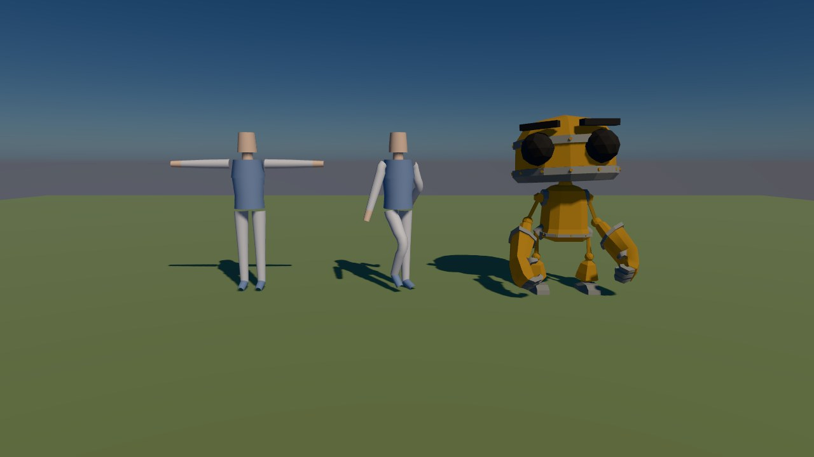
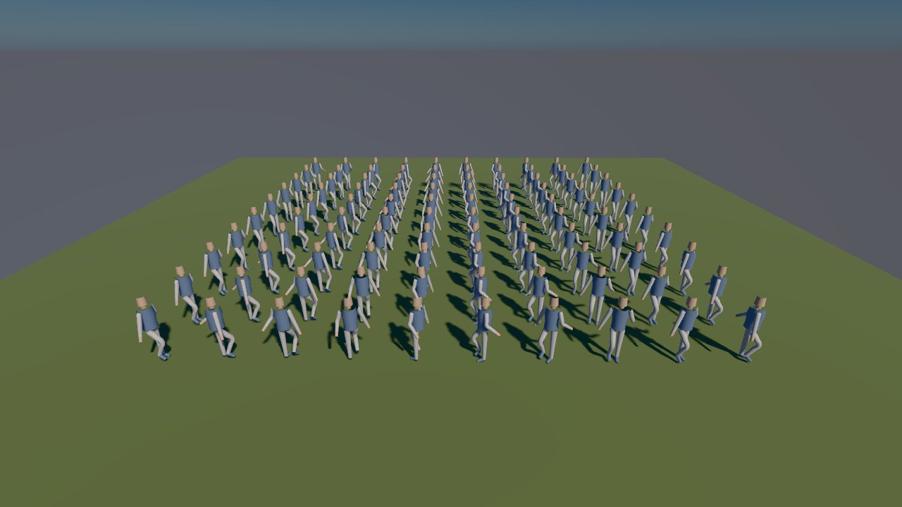

# NoorEngine Devlog #065 — Bending Knees

**Date:** 2026-11-20
**Build / commit:** Milestone 8C, part 1: skinned meshes

## This week we actually did

**Milestone 8C has started: skeletal animation.** Until now, every 3D model in NoorEngine was rigid. A character could
move about, but its arms and legs couldn't bend. Part 1 teaches the engine **skinning**: a character's mesh follows a
skeleton, every vertex pulled along by up to four bones, so elbows and knees bend smoothly.

*Ward in his bind pose, Ward posed by his skeleton (look at that knee), and the robot. Now a golden test.*

- **Skins come straight from glTF**, the way Blender exports them. (Real Rigify and Mixamo files get their test in
  part 5, retargeting; so far the rigs are our own and one free robot.)
- **Bones are things you can grab.** Every bone of a placed character is an entity, like any other object in the
  scene. Turn the knee in the Inspector and the leg bends. Parent a sword to the hand and it goes where the hand goes.
- **Shadows bend too.** The skinning happens on the graphics card, for the picture and for the shadows alike.
- **Even odd files work.** The test robot (free to use, by Quaternius) is mostly rigid pieces riding on bones, with
  only its hands skinned, and its whole skeleton is scaled by a hundred. It comes in right.

Animations (walking, running, waving) arrive in part 2. For now the characters hold whatever pose their file gives
them, which already proves the whole path from file to bent knee.

## Build of the Week 🏆

**A hundred characters, a fifth of a millisecond.**

One hundred skinned characters, each with 17 bones and nearly 3,000 triangles, cost the graphics card 0.2 to 0.4 ms a
frame, shadows included.

## Sage vs. Reality

**Meet Ward.** No free-to-use character was smoothly skinned *and* shaped like a person, so I built one: Ward, made
by a script out of tubes, with Rigify-style bone names. He's not handsome, but he's ours, and he bends exactly where he
should.

**The first character was right by luck.** In my first picture, the T-posed Ward was perfect and the posed one had
collapsed into a little grey lump. The bug: I'd counted where each character's bones start in the wrong units, bones
instead of rows. The first character starts at zero, where both are the same, so he looked fine. The second read the
first one's bones, scrambled. One multiplication, and both stood up.

**The giant robot wasn't a bug.** He came in eight metres tall and I went looking for a broken scale. I worked his
size out by hand from the file: he really is about four metres tall there, and our picture was right. In the test
scene he's now scaled down to Ward's height.

**A plan changed, on purpose.** The plan said bones would live in a hidden pose, not as scene objects. But NoorEngine
has always turned every node of a model into an object when you place it, bones included, so the robot's rigid parts
already hang off its bone objects. Fighting that would have cost more than it saved, so bones stay objects. The cost
is measured rather than feared: a hundred characters take about 1.2 ms of CPU to gather each frame. Part 2 will
measure again with everything moving.

## Next engineering target
**Part 2: clips and the player.** Read the animations inside the files (the robot has fourteen), play them, loop
them, and let scripts start them and hear when they end.

## Bad Ideas Works Award for Questionable Decisions
**Winner:** Building a test person out of drainpipes and naming him Ward.
**Defence:** He stands perfectly still in a T-pose for hours and never complains. The ideal colleague.
