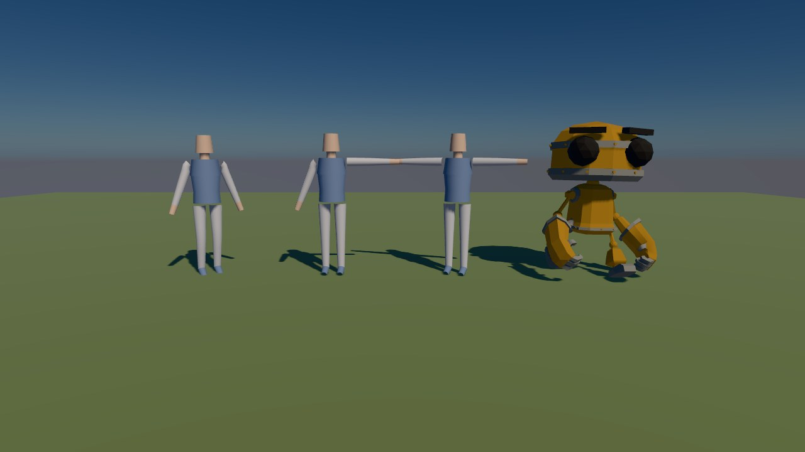
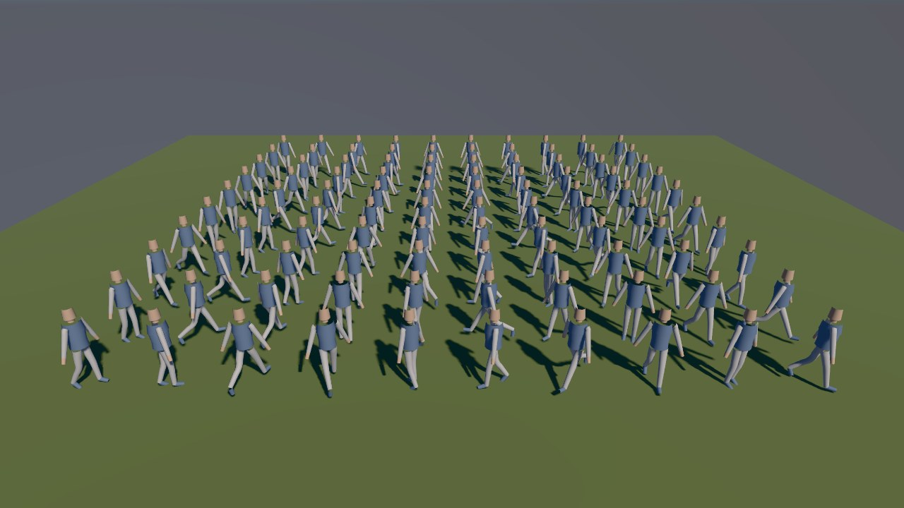

# NoorEngine Devlog #066 — Ward Walks

**Date:** 2026-11-20
**Build / commit:** Milestone 8C, part 2: clips and the player

## This week we actually did

**Characters move now.** Last time they could bend; this time they play animations. Part 2 reads the animations
inside a character's file (a walk, a wave, the robot's fourteen moves) and plays them, frame by frame, the same way
every time.

*Three quarters of a second in: Ward walking, Ward waving (his arm on its way down), Ward nodding, and the robot
walking. Now a golden test, so every bone has to be exactly here.*

- **Give a character an `animator`, name a clip, done.** No script needed for a looping idle or a walk: it plays on
  the scene's own clock. Set it to play once and it holds its last pose.
- **Scripts take the wheel.** Lua and C# can play a clip, speed it up, freeze it, and hear when a one-shot has
  finished (`on_animation_end`), with exactly the same calls that already drive sprites. Coth and Ward now speak the
  same language.
- **All three kinds of glTF keyframes**: hold-until-the-next, straight between, and smooth curves. Each is checked
  against values worked out by hand, not against itself.
- **Same in a built game, to the bit.** A test plays Ward's wave, nod and walk from Lua in the editor's project, from
  Lua in a built game and from C# in a built game, then compares a fingerprint of every bone. All three match.

## Build of the Week 🏆

**A hundred Wards, out of step on purpose.**

Each one starts his walk a little later than his neighbour, so it looks like a crowd and not a marching band.
Animating all hundred costs under half a millisecond a frame on the CPU, and drawing them a fifth of one on the
graphics card.

## Sage vs. Reality

**My test was too polite.** The first version posed bones at the *start* of each frame, while everything else is
drawn at the frame's *end*: characters were one frame behind. My own test said 45 degrees, measured 43.5, and let it
pass because I'd been generous with the tolerance. A second test (freeze a clip and check it stays put) caught it.
Tolerances are tight now.

**Lua and C# can't agree what a second is.** The built-game test failed: the C# Ward walked on one frame later than
the Lua Ward. The engine was fine; my test scripts weren't. Adding up sixty sixtieths of a second gives *just under*
1 in Lua's maths and *just over* 1 in C#'s, so "after one second" happened on different frames. The scripts now count
frames, and the docs warn anyone who writes in both languages.

**Picking which bones to move.** Moving only the bones the current clip touches sounds efficient, but then a wave
followed by a nod leaves the arm hanging up. So each character moves every bone that *any* of its clips touches, and
the rest (the mesh, the bits nothing animates) are left alone.

## Next engineering target
**Part 3: blending and the controller.** Right now switching from walk to wave snaps. Next: smooth cross-fades,
blending walk into run by speed, upper body waving while the legs keep walking, and a state machine to tie it together.

## Bad Ideas Works Award for Questionable Decisions
**Winner:** Teaching a man made of drainpipes to wave before teaching him to stop walking.
**Defence:** Ward has never been told where he is going. He seems happy about it.
