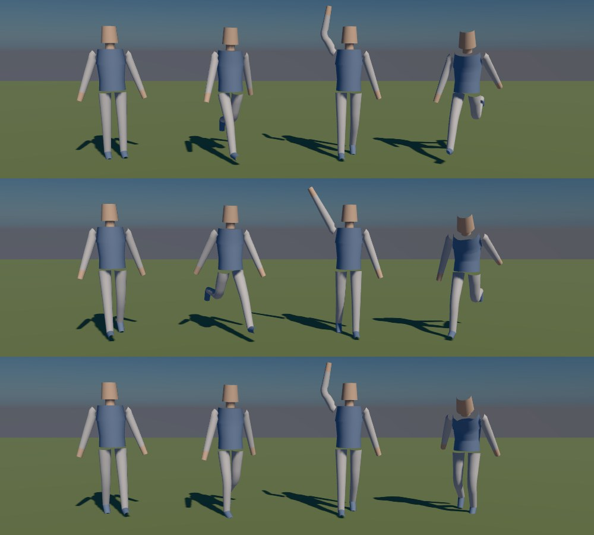

# NoorEngine Devlog #067 — Walking and Waving

**Date:** 2026-11-20
**Build / commit:** Milestone 8C, part 3: blending and the controller

## This week we actually did

**Characters can do two things at once now, and change their minds smoothly.** Part 2 played one animation at a time,
and switching snapped like a cut in a film. Part 3 blends.

*Three moments, one controller, four sets of settings: between idle and walk, between walk and run, walking and
waving, running and leaning. All three moments are golden tests now.*

- **Cross-fades.** A script can say "go from walking to running over a quarter of a second", and the two blend
  instead of jumping.
- **Speed decides the gait.** Give a character idle, walk and run clips and one "speed" number, and it blends between
  them by itself. The clips stay in step, so the feet land together even though a run is shorter than a walk.
- **Upper body, lower body.** A layer can take over just some bones: Ward waves with his right arm while his legs keep
  walking. Another kind of layer *adds* movement on top of whatever is playing, so he can lean into a run.
- **Controllers.** A new file type, `.nooranim`, ties it together: parameters scripts can set ("speed", "waving", a
  "nod" trigger), states, and the rules for moving between them ("when nod is triggered, nod; when the nod is over,
  go back to moving"). Lua and C# use the same calls.
- **Still the same, every time.** A script drives Ward's controller for four seconds in the project, in a built game
  and from C#. All three end with every bone in the same place, to the bit.

## Build of the Week 🏆

**A transition that lands exactly on its frame.** A test sets the "nod" trigger, and Ward starts nodding on that very
frame. The 0.1-second fade finishes after exactly six frames, the one-second nod ends on its 60th frame, and he's back
to walking on the 61st. Not roughly: exactly.

## Sage vs. Reality

**My test put the systems in the wrong order.** In the first run, the controller noticed the script's trigger a
frame late. The engine was fine: in the real game, scripts run before animation, and my test had added them the other
way round. The test follows the game's order now.

**A clip's end was a frame late.** While I was in there, I noticed part 2 reported a one-shot clip as finished one
frame after its last pose was shown. Now it's the same frame. Every built-game check still agrees across all three
runs; only the moment moved.

**Part 2's script docs were stale.** The Lua and C# reference pages still said `play_animation` only works on sprites.
They describe animators and controllers now.

**No trigonometry in blending.** Blending uses plain multiply-and-add maths, with no sines or cosines, so it gives the
same answer bit for bit on every machine. Halfway between two rotations it lands exactly where the fancier method
would.

## Next engineering target
**Part 4: root motion and characters.** Right now Ward walks on the spot. Next, his walk moves him (through the
character controller, so walls stop him), props ride on bones, and Create ▸ Player gets an animated character.

## Bad Ideas Works Award for Questionable Decisions
**Winner:** Teaching Ward to wave, walk and lean at the same time before he can actually go anywhere.
**Defence:** He's very good at it. He's just stuck on a treadmill only he can see.
