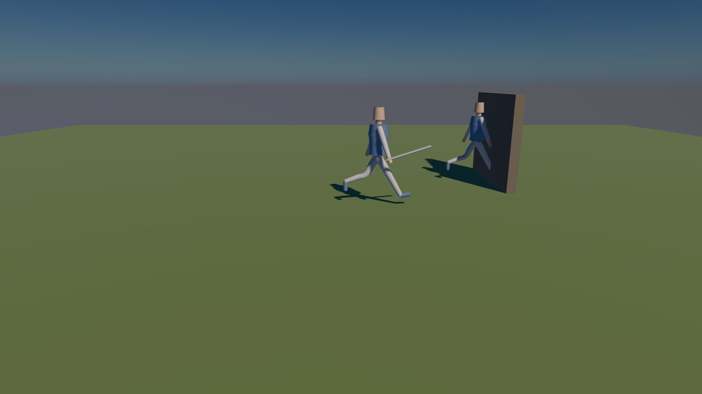
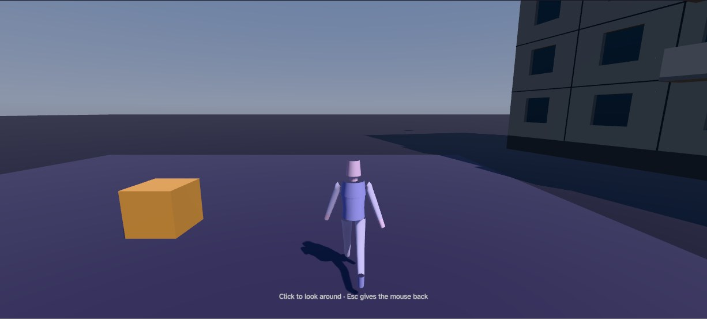

# NoorEngine Devlog #068 — Ward Goes Places

**Date:** 2026-11-20
**Build / commit:** Milestone 8C, part 4: root motion and characters

## This week we actually did

**Ward has left the treadmill.** Until now his walk moved his legs and nothing else. Part 4 brings **root motion**:
the walk itself carries him forward, exactly as far as the animation says, and a wall stops him.

*Two and a half seconds in: one Ward has walked 3.5 metres with a sword in his hand; the other walked into a wall and
stopped right at it. A golden test now.*

- **The animation moves the character.** Turn on `root_motion` and a walk that steps 1.4 metres per cycle moves Ward
  1.4 metres per cycle, through the character controller, so walls, slopes and steps all work. Tested to within a
  centimetre.
- **Footsteps.** Animations can name moments ("left foot down"), and scripts hear them. Footstep sounds, a sword
  swing landing, dust puffs: all hang off this.
- **Props on bones.** A sword is just an object parented to Ward's hand bone, and it goes wherever his hand goes.
  Scripts can find any bone by name.
- **Create ▸ Player (third person).** One click gives you a playable character: Ward on his controller, a camera
  that orbits with the mouse, and a script. WASD walks, Shift runs, and Ward turns to face where he's going while
  idle, walk and run blend by speed.

*Create ▸ Player (third person), Play, hold W. The editor's own smoke test does exactly that, every run.*

## Build of the Week 🏆

**Three runs, one millimetre.** A script listens to Ward's footsteps and speeds him up after the fourth. He walks into
a wall. We run that in the editor's project, in a built game, and again with the script written in C#. All three
leave him at the same spot to the millimetre, with every bone in the same place.

## Sage vs. Reality

**My screenshot showed the wrong player.** The editor test passed, but its picture looked through the *first-person*
player's eyes, left over from an earlier check: Play uses the first camera it finds. The test now moves that player
aside for a moment, and the picture shows Ward from behind, as intended.

**A backslash went missing.** One Python patch turned `'\\'` into `'\'` in C#, and the editor didn't compile. Fixed by
hand. Escaping is still the final boss.

**Free sockets.** The plan had "sockets" as a feature to build. Because bones are ordinary objects (the decision from
part 1), a socket is just "parent the sword to the hand". The only new code was a way for scripts to find a bone by
name.

## Next engineering target
**Part 5: retargeting.** One animation, many bodies: a walk made for one skeleton played on characters with different
proportions and different bone names (Rigify, Mixamo, the Unreal mannequin).

## Bad Ideas Works Award for Questionable Decisions
**Winner:** Giving a man made of drainpipes a sword before giving him a face.
**Defence:** You don't need a face to look heroic. You need a sword. Ward agrees (silently).
