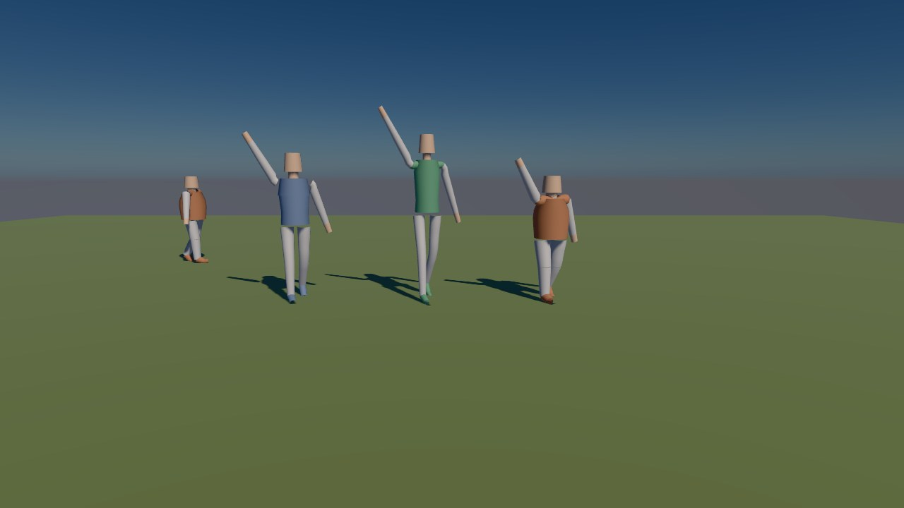

# NoorEngine Devlog #069 — Ward Has Cousins

**Date:** 2026-11-20
**Build / commit:** Milestone 8C, part 5: retargeting

## This week we actually did

**One walk, many bodies.** Until now an animation only played on the skeleton it was made for. Part 5 brings
**retargeting**: Ward's clips play on characters who are taller, shorter, stouter, built in a different pose and whose
bones are named by a different tool.

*Ward (blue) and his new cousins Mast (green) and Bollard (rust), all on Ward's walk and Ward's controller, all waving.
At the back, another Bollard walks across on root motion with Ward's walk. A golden test now.*

Meet the cousins (both made by our own script, like Ward):

- **Mast** is 2 metres tall and named the way **Mixamo** names bones (`mixamorig:LeftArm`), built in a T-pose, with
  Mixamo's habit of keeping bones in centimetres under an armature scaled to a hundredth.
- **Bollard** is 1.45 m and stout, named the way **Rigify** names its deform bones (`DEF-spine.003`, with the twist
  bones in his arms), built in an **A-pose** with Blender's rolled bone frames, so every joint has a rest rotation.

What makes it work:

- **A bone map.** Each body gets a humanoid map: which bone is the hips, the left upper arm, and so on. It's detected
  from the names (Rigify, Mixamo, the Unreal mannequin, Blender's metarig, or just common words like "UpperArm_L"),
  and can be corrected in the model's settings. When something's missing or odd, the log says so in plain words.
- **Directions, not raw rotations.** Copying rotations from a T-pose skeleton to an A-pose one twists limbs. Instead,
  each of Bollard's bones is first turned to point where Ward's points at rest, then turned the same way Ward's turns.
  So the bones point the same way at every moment. Tested to within two degrees.
- **Shorter legs, shorter steps.** The hips move by Ward's movement scaled by leg length, so Bollard's walk covers
  less ground and root motion follows.
- **Just add `retarget_from`.** On an animator, it names the model whose clips to borrow. They become this model's own
  clips, so controllers, blending, root motion and footstep events all work unchanged.

## Build of the Week 🏆

**Bollard in a built game.** The script that drives Ward's controller (speed up to a run, a nod, a wave) now drives
Bollard, with Ward's clips retargeted. The project, a built game, and the C# version all end with every bone in the
same place.

## Sage vs. Reality

**The hundredfold walk.** Mixamo-style characters keep their bones in centimetres under an armature scaled to 0.01.
Root motion (part 4) read the hips' movement in the bones' own units and handed it to the character as metres. Mast
would have strode 140 metres every walk cycle. Part 4's tests never caught it: Ward has no armature scale. Now the movement
is brought into the model's space first, and a test walks Mast through his centimetre armature.

**The mask that didn't travel.** Ward's controller lets his arm wave on its own layer, with a mask naming
`DEF-upper_arm.R`. Mast doesn't have that bone; his is `mixamorig:RightArm`. The first render showed Mast walking but
not waving, and a polite warning. Masks now translate names through the bone maps, and may also name humanoid bones
directly (`RightUpperArm`).

**A stale line.** The animation docs still listed root motion as "not yet", a part after it was done. Gone.

## Next engineering target

**Part 6: the Animation panel.** Scrubbing clips on a timeline, seeing the skeleton, editing a controller's states
and transitions, and seeing a model's bone map with its detected preset and warnings.

## Bad Ideas Works Award for Questionable Decisions

**Winner:** Naming the new characters after a ship's mast and the post you tie it to.
**Defence:** Ward is built from drainpipes. The family has a theme. We are not taking questions.
