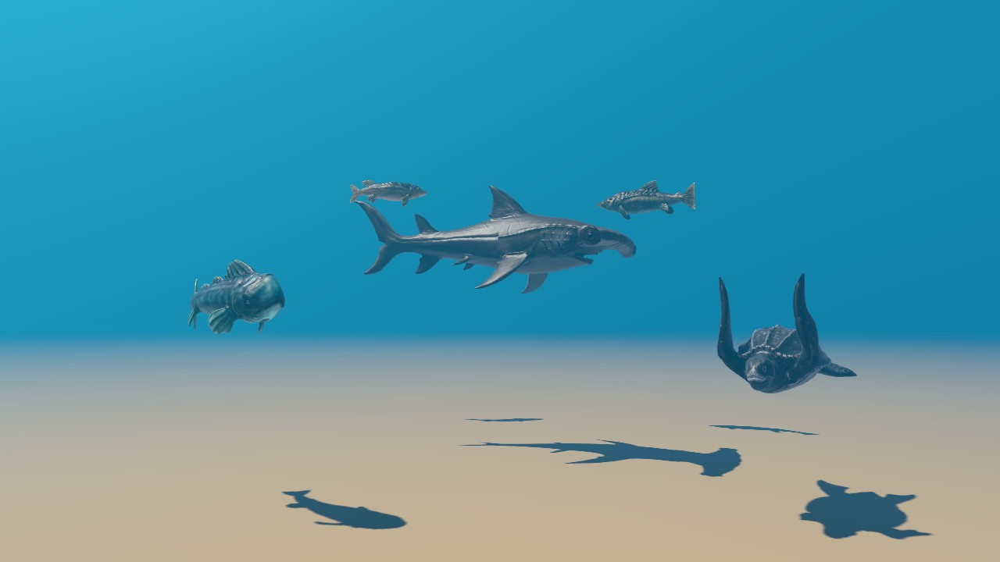
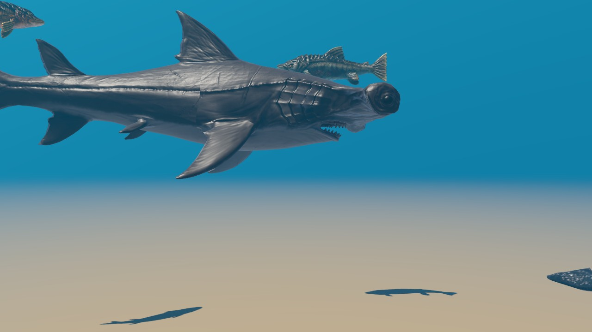

# NoorEngine Devlog #071 — FBX Was Fine, Actually

**Date:** 2026-11-20
**Build / commit:** Milestone 8C, part 7: FBX

## This week we actually did

**FBX files import.** The plan said "research first": try ufbx (MIT) on real FBX files, and if it holds up, write an
importer; if not, write down why. It held up. FBX characters, their skins, their animations, their meshes and materials
now come into NoorEngine exactly like glTF ones, and every part of the engine that takes a model takes an FBX.

How do you tell whether an importer is right? You find a second opinion. Every file was read twice: once by
NoorEngine, once by Blender, and the two readings were compared joint by joint, 30 times a second through every
animation, and vertex by vertex for the drawn shape.

**133 files**: our own characters exported by Blender 5.2 and 3.3; 97 files of store-bought deep-sea creatures from
one of Tom's projects (eight fish, a hammerhead, a sea turtle, a nautilus, a mantis shrimp, a horseshoe crab, written
by Autodesk's FBX SDK); 18 of Synty's animation files from Maya; and a dozen big static meshes from Blender and Meshy,
the largest 1.2 million triangles. Not one failed to import. The creatures agree with Blender to within a tenth of a
millimetre, and our own characters to within a thousandth, once Blender is asked to export without its shortcuts.

*Store-bought creatures from Tom's deep-sea project, imported from their FBX files and each swimming on its own
separate clip file. The creatures aren't in the repository (their licence covers using them, not handing them out).*

*Closer: the hammerhead's skin and normal maps, found next to the FBX where the file says they are.*

**Clips in files of their own.** FBX packs ship a character as a mesh plus one file per animation. NoorEngine now plays
those: give the character's animator the clip file, and if the skeleton is the same, the animation is copied over bone
by bone, on any rig. All 79 of the creatures' clip files play on their creatures.

## Build of the Week 🏆

**The second opinion.** `noor_cli compare-models` compares any two imports of the same model, and a small script runs
it against Blender's reading of a whole folder of FBX files. It's how every difference below was found, and how each
one was traced to the side that was wrong.

## Sage vs. Reality

Every disagreement started as "my importer is wrong" and mostly ended as "Blender did something":

**The hand that wouldn't rest.** Ward's right hand sat 13 mm off in three of his clips. Blender's FBX exporter keys
every bone in every take (for Unreal's sake), and a bone an animation doesn't move gets whatever pose it was last left
in. The fix was in our export script: clear the pose first.

**A millimetre and a half.** Blender thins FBX animation curves by default. Turned off, Ward matched to 0.001 mm.

**Blender 3.3 had a day.** Its glTF exporter got some of Ward's clips wrong, its glTF of the robot failed validation,
and its importer turned Ward's leg bones half round. Blender 5.2 does none of that.

**The ones that were ours.** Two were ours. A mantis shrimp's body came out 24 mm off at rest: some of its bones weren't
in the file's "bind pose", so the importer now takes each bone's rest from the skin itself. And a fish's 4-second swim
lasted 15.9 seconds in Blender: an FBX take keeps its place on the file's timeline. We play it from its own start, as
games do, and the comparison now knows to line the two up.

**The test that never ran.** A check that FBX clips copy correctly onto a glTF skeleton passed for an hour, because an
`if` around it never fired. They don't copy, rightly: Blender's FBX armature is in centimetres and lies on its back
inside a turn that undoes it. The check now says so out loud.

## Next engineering target

**Part 8: the sample and the 8C review.** Alden walking about Hillside on his controller, a crowd benchmark, and the
milestone's gate.

## Bad Ideas Works Award for Questionable Decisions

**Winner:** Testing a file format by asking a different program what it thinks, 133 times.
**Defence:** Two readers who agree to a thousandth of a millimetre are either both right or both wrong in exactly the
same way, and Blender has had twenty years to get FBX wrong in its own way.
