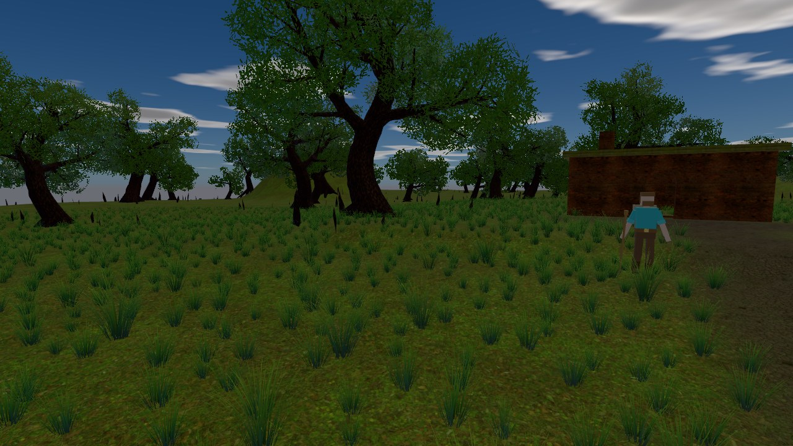
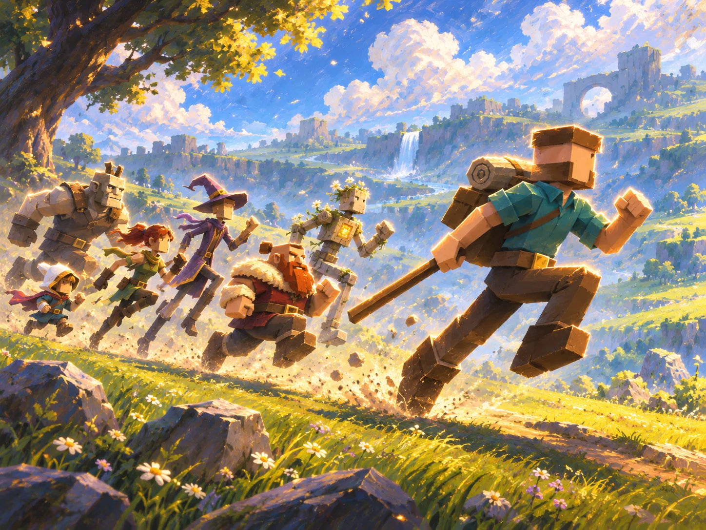
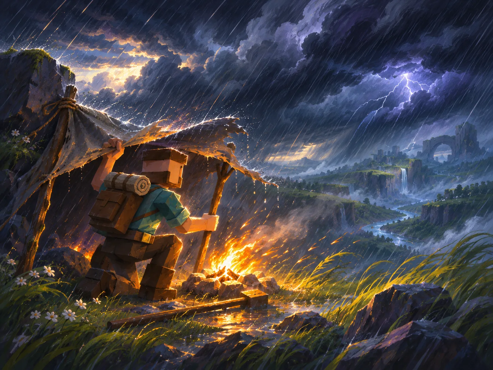

# NoorEngine Devlog #072 — Alden Walks

**Date:** 2026-11-20
**Build / commit:** Milestone 8C, part 8: the sample and the 8C review

## This week we actually did

**Alden Wayfarer, NoorEngine's mascot, walks.** He has been in the devlog since #015 as a concept sheet and a Godot
placeholder. Now he's a character in the engine: built by a script from the concept sheet (blocky; short brown hair and
a beard; a teal tunic with rolled sleeves; the belt with the gold buckle; the backpack with its bedroll; his staff),
standing on the same skeleton as Ward, so everything Ward learned this milestone, Alden knows too.

*The 8C sample: Alden wandering about Hillside, five seconds in. A golden test now.*

In the sample he wanders a loop by the house: walks, runs a stretch, stops for a breather, walks on. Nothing pushes
him: his walk and his run carry him (root motion), his controller blends idle, walk and run by how fast he's going,
and his little script only steers and sets the pace. His staff is its own model, riding on his right hand's bone. And
the built Hillside game plays him exactly as the editor's project does: every bone, his place to the millimetre.

That closes **Milestone 8C, skeletal animation**: skinned characters, clips, blending and controllers, root motion,
retargeting between bodies of every shape, the Animation panel, and FBX. The [review](../milestones/M8C_REVIEW.md) goes
through it system by system: the gate passes.

## Build of the Week 🏆

**A crowd of Aldens.** The benchmark fills the valley with them: 100, then 250, each with his own character
controller, script, controller and staff. The graphics card shrugs (the frame costs the same as an empty valley).
The processor notices: about 35 µs a character, so 100 fit a frame easily and 250 take 9 ms. Where it goes is written
down, and so is the likely fix.

## Alden discovers ... everything, at once

Every milestone, Alden discovers what the engine just learned; each review gets a line and the line a picture. Until
today, the lines had no pictures. Tom asked which were missing, and Noor painted **all ten**, from the first light of
Milestone 1 to this one, in one afternoon. They're in the reviews now
([the list](../milestones/ALDEN_DISCOVERIES.md)).

*Milestone 8C: Alden discovers that he can move. Picture: Noor.*

*8A: the sky. Picture: Noor.*

*8B: the weather. Picture: Noor.*

## Sage vs. Reality

**The leg he skipped.** The first run had Alden sprinting from the first frame. He started standing on his first
waypoint, so the script arrived at once and moved on to the running leg. He starts at the last point now.

**Seventeen bones, nine moving.** The built-game check expected all seventeen of his bones to be posed. His idle, walk
and run move nine (hips, chest, legs, upper arms); the rest stay at rest, as they should. The check was wrong, not him.

## Next engineering target

**Milestone 8D: water.** Lakes and a sea, reflections, shorelines that read the terrain, and underwater: light fading
with depth, and a surface seen from below. It starts with a plan.

## Bad Ideas Works Award for Questionable Decisions

**Winner:** Asking for "the empty file" and getting ten paintings.
**Defence:** Dictation software, and Noor. We are not complaining.
