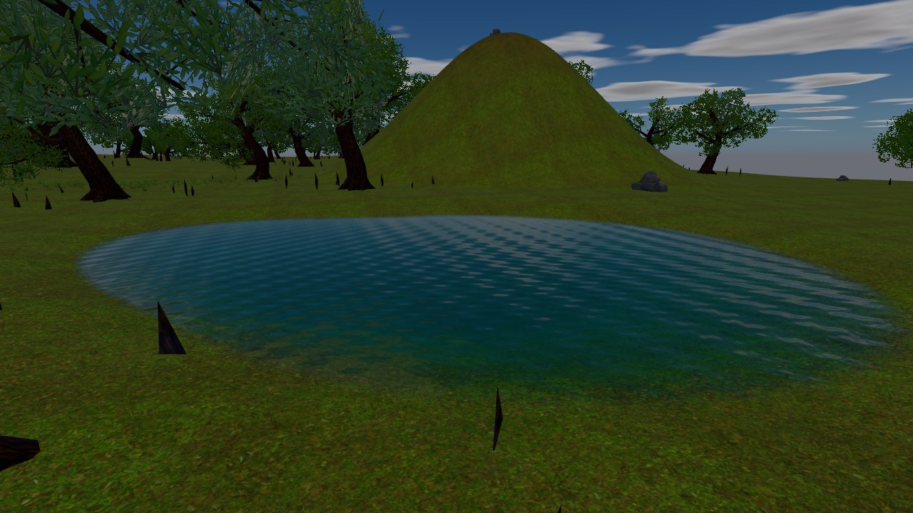
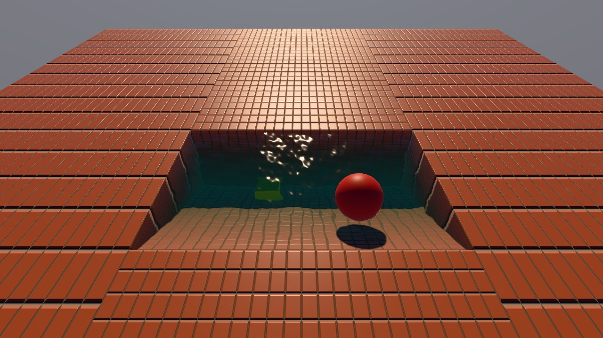
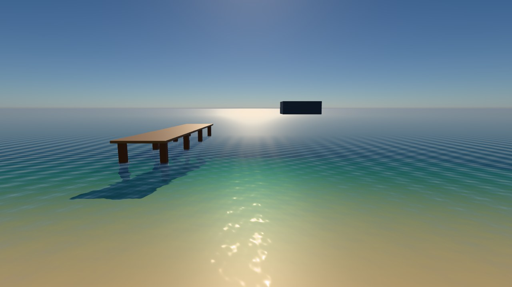

# NoorEngine Devlog #073 — A Lake in the Valley

**Date:** 2026-11-20
**Build / commit:** Milestone 8D, part 1: the water surface

## This week we actually did

**Hillside has a lake.** The valley north of the house had a shallow dip; it's a hollow now, and there's water in it.
You see the grass on the bottom where it's shallow, then it turns green, then teal, then dark where it's deep, the
way real lakes do, the ripples wobbling the bottom.

*The Hillside lake, half a second in. A golden test now.*

No colour in it is painted on. The water is told how much of each colour light loses per metre ("by four metres, white
light has turned this green"), and every pixel works out how much water its light went through: down to the bottom
and back up to your eye. Red goes first, then green, so the deeper it gets, the bluer-green. That's the whole trick,
and it's the real one (Beer and Lambert worked it out a while ago).

To know how deep the water is at a pixel, the water has to see what's under it. So when there's water in view, the
frame now draws the ground first, **copies the picture and its depth once**, then draws the water on top, reading the
copy. That's also how the bottom wobbles under the ripples (refraction: the copy read a little to the side) and how
the shoreline fades in softly instead of drawing a hard line on the grass.

*The test pool: a ramp floor from 15 cm to 2 m. Watch the yellow block at the deep end go green.*

And there's a sea: the same water, drawn under the camera out to the horizon, where the haze swallows it.

*The endless sea, flat for now: waves are part 2.*

## Build of the Week 🏆

**The copy is cheap.** The plan's top risk was copying the scene every frame: with 4× anti-aliasing it means
resolving and copying both the picture and its depth. Measured: **0.02 ms** for the copy and about **0.04 ms** for the
lake at 1280×720, about 0.1 ms in all. Nothing at all without water. The GPU's timings now show the copy and the
see-through pass as their own lines, so this stays measured.

## Sage vs. Reality

**The grid on the lake.** The first lake had a checkerboard on it: four sine waves too small to see at a distance,
aliasing into a pattern. Ripples now fade out when a pixel covers more than a slice of a wave, and roughen the
reflection instead, the way a far-off rippled lake just looks a bit blurry.

**The pond behind the tree.** The first camera put an oak trunk right in front of the lake. Moved.

**The valley wasn't a valley.** The floor of Hillside is nearly flat: a lake there would have shown a straight edge
where the water's rectangle ended. The lake scene digs a hollow in its own copy of the sculpt layer (so the other
Hillside scenes keep their ground) and checks that every point of the water's edge is on higher ground.

**The test that counted passes.** The editor's smoke test expected six GPU pass timings. There are eight now.

## What it isn't yet

The surface is flat apart from its ripples (waves: part 2). It reflects the sky and the sun, but not the house or the
trees (screen-space reflections: part 3, with foam on the shore). No underwater view (part 4), nothing floats (part 5),
no rivers (part 6).

## Next engineering target

**8D, part 2: waves.** Gerstner waves from the wind, the sea's grid following the camera, and `water_height(x, z)` for
scripts, with a test that the CPU's answer and the drawn surface agree.

## Bad Ideas Works Award for Questionable Decisions

**Winner:** Digging a lake to find out whether copying a picture is slow.
**Defence:** It wasn't. And now there's a lake.
