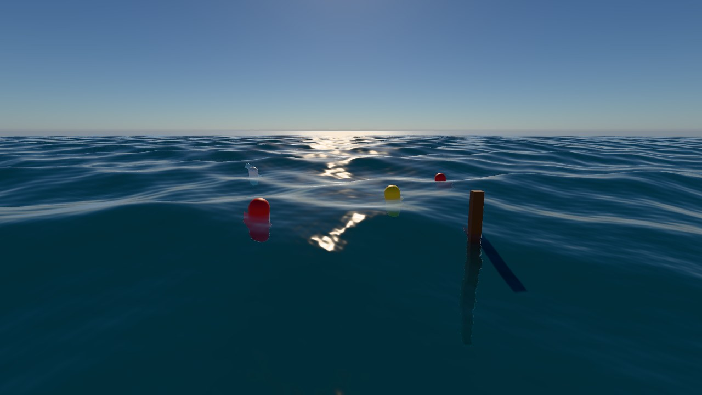
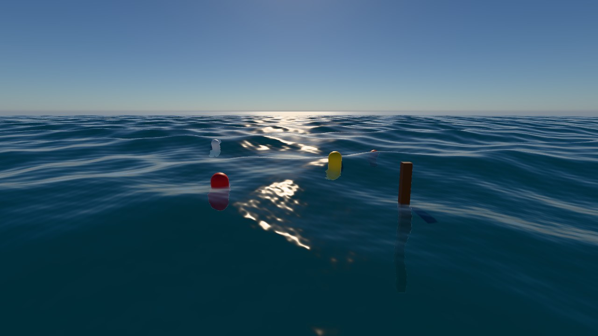

# NoorEngine Devlog #074 — Making Waves

**Date:** 2026-11-20
**Build / commit:** Milestone 8D, part 2: waves

## This week we actually did

**The sea moves.** A long swell with smaller waves running across it, crests a little sharp, troughs a little wide, the
sun's path breaking up on them. And four buoys bobbing along, which is the actually important bit.

*The Sea preset, one second in.*

*Three seconds later. Both are golden tests now.*

The waves are Gerstner waves: each point of the surface goes round in a little circle as a wave passes, which is how
real swell moves, and why crests come out sharper than the troughs. Four of them: one big one from the preset, three
smaller ones crossing it. Each travels at the pace real deep water gives a wave of its length (a 14 m wave takes about
3 seconds to pass you). The wind can make them taller.

**The buoys aren't animated.** Each has a five-line Lua script that asks `noor.water_height` where the surface is and
sits there, tilted to the surface's slope. That's the part that matters for games: floating crates, swimming, boats.
Gameplay has to know exactly where the water is, and it has to be where the water is *drawn*.

## Build of the Week 🏆

**Six millimetres.** The same wave formula runs twice: on the CPU for gameplay and on the graphics card for drawing.
To prove they agree, the test reads back the depth buffer under the waves (576 pixels), turns each pixel back into a
point in the world, and asks gameplay how high the water is there. Within 20 m of the camera, the worst disagreement is
**6.2 mm**; within 10 m, 2 mm. And the built game floats the buoys in exactly the same places as the editor's project,
to the last bit.

The sea is drawn as rings round the camera, each a bit wider than the last, out to 20 km: fine where you're looking
down at your feet, kilometres wide at the horizon. About 670,000 vertices, about 0.1 ms.

## Sage vs. Reality

**The formula from the book.** The famous GPU Gems chapter on Gerstner waves has a compact formula for the surface's
normal. The unit test compared it with the slope measured from heights a few centimetres apart, and at one point out of
twelve it was 2 cm per metre off. The compact formula drops the waves' cross terms, which matter on choppy crests. Both
sides now cross the surface's two tangents: the exact normal, and it agrees.

**A kilometre out.** Before that, I blamed floats: a kilometre from the origin a wave's phase is in the thousands of
radians. True, but harmless for the height, and the gap didn't move when I changed the step. It was the formula.

## Tom asked

"I'm hoping we'll be able to achieve those nice, crisp waves like in Sea of Thieves." Some of that is already a matter
of turning the dials (taller, shorter, choppier waves). The rest is on the list: foam on crests and at the shore (part
3), a gallery of presets with live editing (part 7), and in the ideas inbox: light glowing through the thin top of a
wave, foam where waves are steepest, more waves than four, and a stylised shading option. Our own style in that
spirit.

## What it isn't yet

Waves don't feel the depth yet: they don't calm in the shallows or break on a beach (part 3). Far out, where the grid
is too coarse for the smallest waves, the drawn sea is calmer than the one gameplay reads (documented). Nothing pushes
floating bodies yet (part 5).

## Next engineering target

**8D, part 3: shorelines and reflections.** Each body's depth map from the ground under it, waves calming in the
shallows, foam and wet sand at the waterline, and screen-space reflections, so the lake finally shows the house.

## Bad Ideas Works Award for Questionable Decisions

**Winner:** Building a depth readback, a probe grid and a built-game comparison to prove four buoys are bobbing correctly.
**Defence:** They are. To six millimetres.
