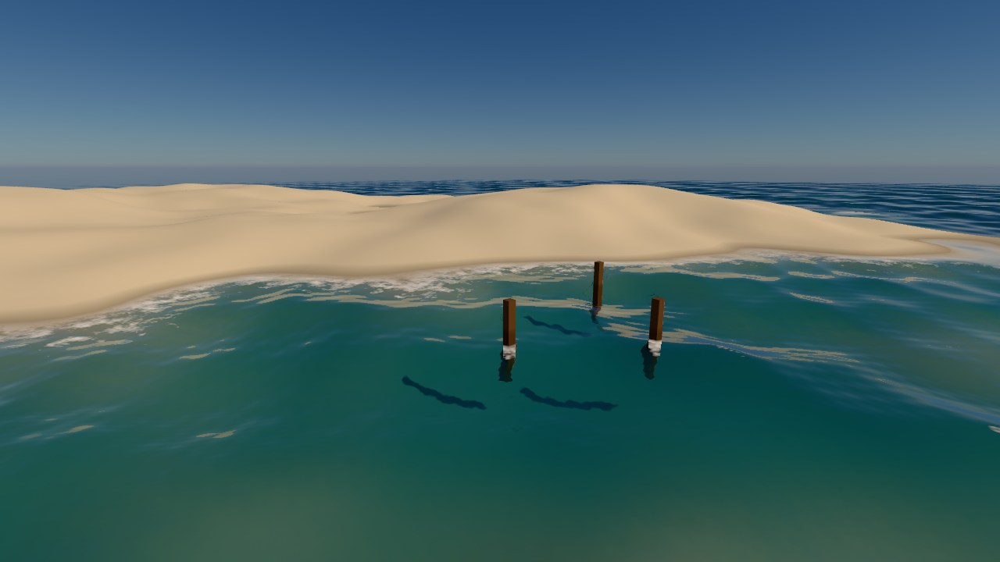
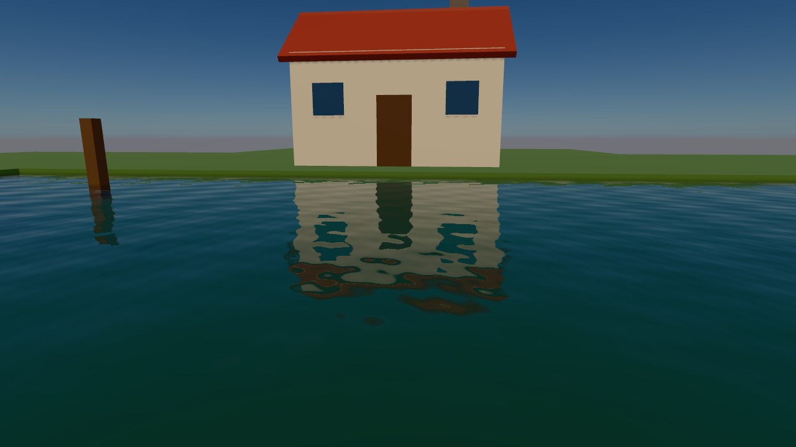

# NoorEngine Devlog #075 — Where the Sea Meets the Sand

**Date:** 2026-11-20
**Build / commit:** Milestone 8D, part 3: shorelines and reflections

## This week we actually did

**The water knows where the beach is.** Each water body now has a depth map: how deep the water is over the ground,
taken from the terrains under it. Waves feel the bottom: as the water gets shallow, each wave shrinks (long waves
first, the way real swell does), and where the ground is above the water nothing moves at all. So the sea stays out of
the dunes instead of slopping through them.

*The Sea preset round a sandy coast (a test scene, and a golden test now).*

**Foam**, in two places. Along the shore and round anything standing in the water, where it's shallow, surging in as
the waves lift the water. And out at sea on crests steep enough to fold: the same formula that moves the waves says
where they squeeze the surface together. Both are laced with noise, so weak foam breaks up into specks and streaks
instead of painting a stripe.

**Wet sand.** A band just above the waterline comes out darker, and so does everything under the water.

**Reflections of nearby things.** Until now the water reflected only the sky. Now each pixel follows its reflected ray
through the picture the camera already has (screen-space reflection) and shows what it hits: the house on the far bank,
the trees round the Hillside lake, the posts. Where the screen has nothing (the roof is off the top of the picture),
it fades back to the sky.

*The house in the pond. The roof is cut off at the top of the picture, so the water can't reflect it and shows the sky
there instead. Also a golden test.*

## Build of the Week 🏆

**Seven millimetres in the shallows.** Last week's proof was that what gameplay reads (`noor.water_height`) is where the
water is drawn, to 6 mm. Calming the waves over a beach could have broken that: now the shader and the CPU each read a
depth map too. So the test went to the beach: the depth buffer read back over the shallows, every pixel checked against
`water_height`. 322 pixels of water within 20 m, 309 of them over shallow water, worst gap **7.4 mm**. A floating crate
in the surf will sit where the surf is drawn.

## Sage vs. Reality

**The bathtub ring.** The first shore foam was a neat grey ring round the whole lake, like a bath nobody cleaned. Foam
now has to beat a noise pattern to show at all: strong foam is solid with holes, weak foam is a few specks.

**The house in the lake.** The plan said the test would be "reflections of the house in the lake". I went looking: the
Hillside house is 80 metres from the lake, on a rise. From any camera that sees the lake, the far shore hides where its
reflection would be (that's not a bug, it's geometry). So the test scene has its own pond with a house on the bank.
The Hillside lake reflects its trees.

**Optimising the wrong thing.** The reflection march was the expensive part. I swapped its per-step matrix multiply for
one multiply-add (clip space is linear along a ray): no change at all. The cost was waiting on the depth reads, one
after another. Fewer, longer steps (20 instead of 40, still reaching about 75 m) took it from 0.18 to 0.14 ms.

## What it isn't yet

- Only terrains count as ground for the depth map: a beach made of a box (or a mesh) gets foam and wet sand (those come
  from what's on screen) but no calmer waves.
- Waves calm in the shallows but don't slow down, turn to face the shore or break. They just get smaller.
- Screen-space reflections only know what's on screen: the far side of a bridge, or anything behind the camera, is
  sky. Planar reflections stay possible later for mirror lakes (ADR-037).
- Wet sand doesn't dry, or get wet again with each wave. It's a fixed band.
- It costs more: the wavy sea went from 0.11 to 0.32 ms of GPU at 1280×720 (reflections 0.14 ms, foam 0.03 ms).

## Next engineering target

**8D, part 4: underwater.** Fog and colour with depth, the surface seen from below (the bright window overhead, total
internal reflection beyond it), caustics on the bottom, and the waterline across the screen when the camera is half in.

## Bad Ideas Works Award for Questionable Decisions

**Winner:** Building a whole pond, and a house with a chimney, to prove the water can reflect a house.
**Defence:** The plan said "the house". It didn't say which one.
