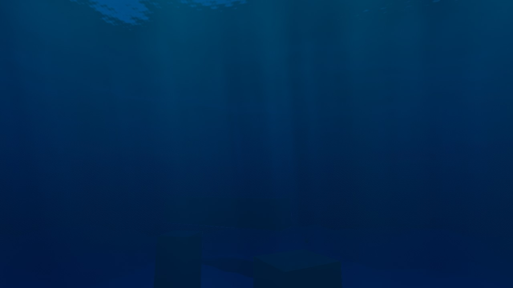
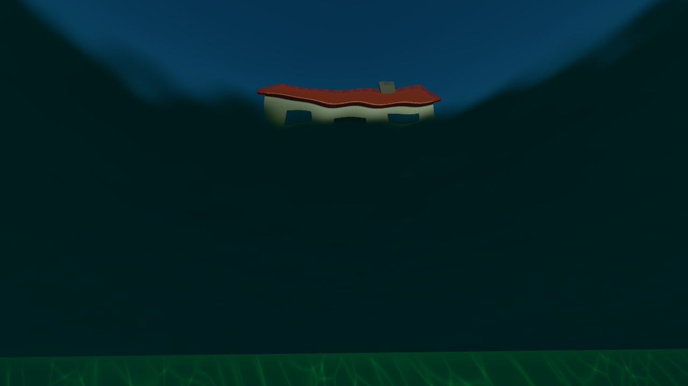
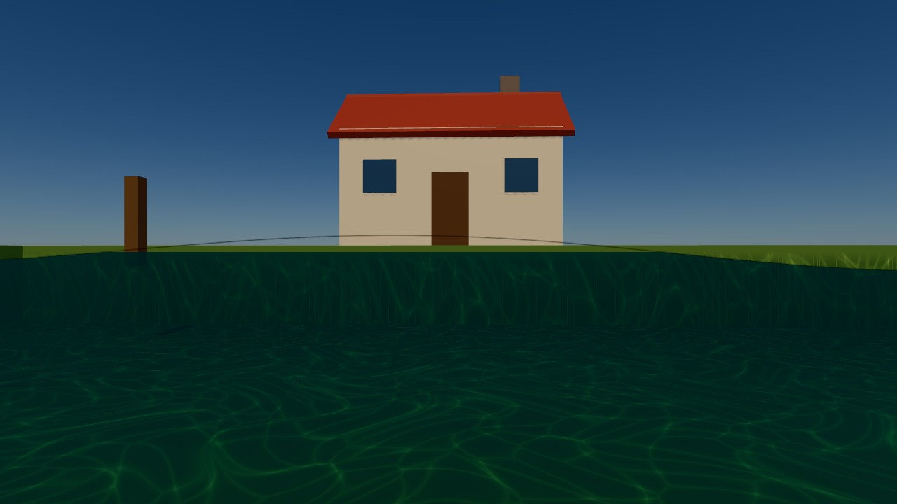

# NoorEngine Devlog #076 — Something Down There

**Date:** 2026-11-20
**Build / commit:** Milestone 8D, part 4: underwater

## This week we actually did

**You can go under.** Tom's brief for this one: "I want to achieve this nice effect that will trigger thalassophobia,
especially in the Thalassa project." Thalassa is Tom's deep-sea game. It started as an experiment in Unreal, and
there's a good chance it ends up being built in NoorEngine. So this part is for it.

*The new Deep sea preset from 18 metres down. The dark shape at the bottom is a box. Your brain will make it something
else.*

What's there now:

- **Light dims with depth.** Under a water body, the sun and the sky reach things through the water above them: red
  goes first, then green, so the deep goes blue and then dark. Local lights don't dim, so a lamp at the bottom of the
  sea still lights what's near it.
- **Fog that is water.** Between the camera and everything it sees, the water swallows the light and glows with what
  it scatters, lit by the sun and sky at that depth. Looking down into the deep goes darker than looking across.
- **Light shafts.** The sunlight in that glow comes down in shafts where the waves bend it, and objects cast shadows
  into the water.
- **Caustics.** The net of bright lines the waves throw on the bottom, drifting. You see it from above too, in the
  shallows and on the pool's tiles.
- **The surface from below.** Overhead, a bright round window shows the sky (and the house on the bank) squeezed into
  a cone 97° wide (that's Snell's law). Beyond its edge the surface is a mirror (total internal reflection), showing
  the water's own dark glow.
- **The waterline.** With the camera half in, each pixel works out whether its bit of the lens is under the surface.
  So the waterline crosses the screen: the world above, the water below, a thin dark line between them.
- **Eyes adjust.** Under water the exposure opens up by half of what the water has taken from the light. Shallow water
  stays bright, deep water gets darker the deeper you go, and at the surface the change is zero, so crossing it doesn't
  jump.

*Snell's window from under the pond: the house on the bank, squeezed against the window's edge.*

*Half in, half out.*

## Build of the Week 🏆

**No pop.** The classic underwater bug is the moment you cross the surface: lighting, fog or exposure switches all at
once, and the picture jumps. The test walks a camera down through the pond, from 30 cm above the water to 30 cm under,
in half-centimetre steps where it matters, and checks the average colour of every picture. The darkening is spread over
11 steps while the waterline sweeps across the lens; the biggest single step is 16% of the whole change.

## Sage vs. Reality

**Pitch black.** My first Deep sea preset made 18 metres down a perfect black rectangle. Two mistakes. I'd given it
absorption like murky coastal water (blue lost at 0.12 per metre; real open ocean loses about 0.02). And the exposure
was still metered for the sky above the surface, so it never opened up. Both fixed. It's still dark down there, just
not "monitor switched off" dark.

**Caustics that looked like tiles.** The first caustics were a neat net of polygons, like a bathroom floor. The fix:
bend the pattern with a slow swirl first, thin the lines, and make them brightest where the two layers cross.

**The window shrank.** I softened the window's edge to stop it shimmering, and overdid it: the window started fading
to mirror at 34° instead of near 48.6°, and the house drowned in the mirror. Now only the last few degrees blend.

## What it isn't yet

- Glass, smoke and other see-through things aren't fogged by the water (they're drawn after it), and particles under
  water don't dim with depth.
- One water body at a time from inside (the first one the camera is in). Light under a body is dimmed for the first
  eight bodies.
- Depth dims the light by the water's level, not by the waves passing overhead.
- Caustics and shafts are patterns shaped like what waves do, not light actually traced through the waves.
- No splashes, bubbles or droplets on the lens yet (part 5 has splashes).
- It costs: from inside, the water takes about 0.3 ms at 1280×720, mostly the shafts.

## Next engineering target

**8D, part 5: water in the game.** Things that float (a crate at the depth its density says, bobbing the same in a built
game), wading and swimming, splashes, rain on the water.

## Bad Ideas Works Award for Questionable Decisions

**Winner:** Spending an afternoon making a box at the bottom of the sea look like it might be watching you.
**Defence:** Tom asked for thalassophobia.
