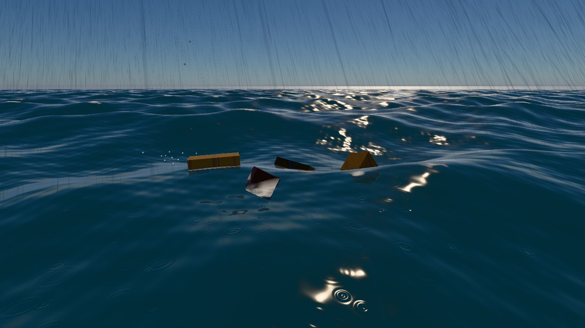

# NoorEngine Devlog #077 — Everything Floats

**Date:** 2026-11-20
**Build / commit:** Milestone 8D, part 5: water in the game

## This week we actually did

**Things float.** Any dynamic physics body in water now floats the way its density says. Each body is cut into small
cells, and every cell under the surface is pushed up by the water it pushes aside, at that cell. So a plank half as
dense as water floats half under, a crate tips until it finds its balance, a barrel lies on its side, and everything
rides the waves. Heavier than water sinks. `"buoyancy": 0` sinks anything.

*The Sea preset in the rain: planks, a crate and a barrel of different densities, pebbles splashing in, rain rings on
the water. A golden test, and the same scene runs in a built game.*

**Characters wade and swim.** Walk into the water and you slow down the deeper it gets. Once it's deeper than about two
thirds of your height you swim: no gravity, held with your chest at the surface, a bit slower. Scripts get the state
("dry", "wading", "swimming", "under") and the depth at the feet and the head, plus an `on_water` event each time it
changes. In Lua that's `e:character_water()` and `on_water(state)`; in C#, `WaterState`, `FeetDepth`, `HeadDepth` and
`OnWater(state)`.

**Splashes.** Particles can collide with the water now: a particle that falls in ends on the surface and fires
`"on": "water"` sub-emitters there. Pebbles, rain on a pond, a dropped crate's spray.

**Rain and wind on the water.** Rain rings the surface with spreading circles, more of them the harder it rains, and
the wind roughens the ripples and blurs the reflections. That's drawing only: gameplay's surface stays the waves.

## Build of the Week 🏆

**Under a micrometre.** The plan asked for a crate floating "at the depth its density says, within a centimetre". Three
planks (300, 500 and 800 kg/m³) dropped into still water settle 0.08 m, 0.00 m and 0.12 m under, which is the textbook
answer, to under a micrometre. And the rainy-sea scene, run in the editor's project and in a built game, puts every
floating body in the same place to the last bit, with the same 12 splashes.

## Sage vs. Reality

**The 8.5 mm mystery.** The first run of the float test passed, but the light plank was 8.5 mm too deep: a pass by
luck, not by design. Jolt puts a body to sleep when it moves slowly enough, which freezes it wherever it happens to be
on its last little bob. On still water nothing woke it up. My first fix woke it whenever the water wasn't holding its
weight exactly, which made it worse: it now bobbed for ever, going to sleep and waking up in a perfect loop every 60
frames. The real fix: a body floating at the surface isn't allowed to sleep, and the water's own drag settles it.
From 8.5 mm off to under a micrometre.

**Cubes don't float the way you'd think.** I almost used cubes for the float test. A cube whose density is between
about a fifth and four fifths of water's doesn't float flat: it rolls onto an edge, and that's real physics. Flat
planks float level, so they make a test you can check by hand. The tilted crate in the picture isn't a bug.

## Also this week: a goblin

Tom made a goblin himself, model, rig and animation, with a rigging add-on for Blender he built himself, and wasn't
sure the export would work. It does: the engine imported it first try and plays its creeping-walk clip, skin and all.
Tom's review of his own animation: "it looks like the goblin has lumbago." Ours: it looks like it's up to something.
The goblin stays on Tom's machine for now, but making that Blender add-on better is now in the ideas inbox.

## What it isn't yet

- Water density is fixed at fresh water's (1000 kg/m³). Floating bodies are cut into cells (3 × 3 × 3 for a box), so a
  tilted body's buoyancy is approximate.
- The water doesn't push floating things along: no currents yet (rivers in part 6 bring flow), and waves lift and tilt
  bodies but don't carry them.
- Swimmers float at the surface: no diving yet. A character falling into deep water goes under and comes back up.
  There's no swimming animation yet; scripts and the animator get the state to drive one.
- Splashes are particles you author (`"on": "water"`); bodies hitting the water don't splash by themselves yet.
- Rain rings and wind ripples are drawing only. The CPU cost of floating hasn't been measured yet (it's a few water
  queries per body per step); the sample in part 8 will measure it.

## Next engineering target

**8D, part 6: rivers.** A water body that follows a spline over the ground and flows: normals and foam moving
downstream, joining a lake, and a floating crate carried along at the river's speed.

## Bad Ideas Works Award for Questionable Decisions

**Winner:** Spending an hour stopping a plank from napping.
**Defence:** It was napping 8.5 mm in the wrong place.
