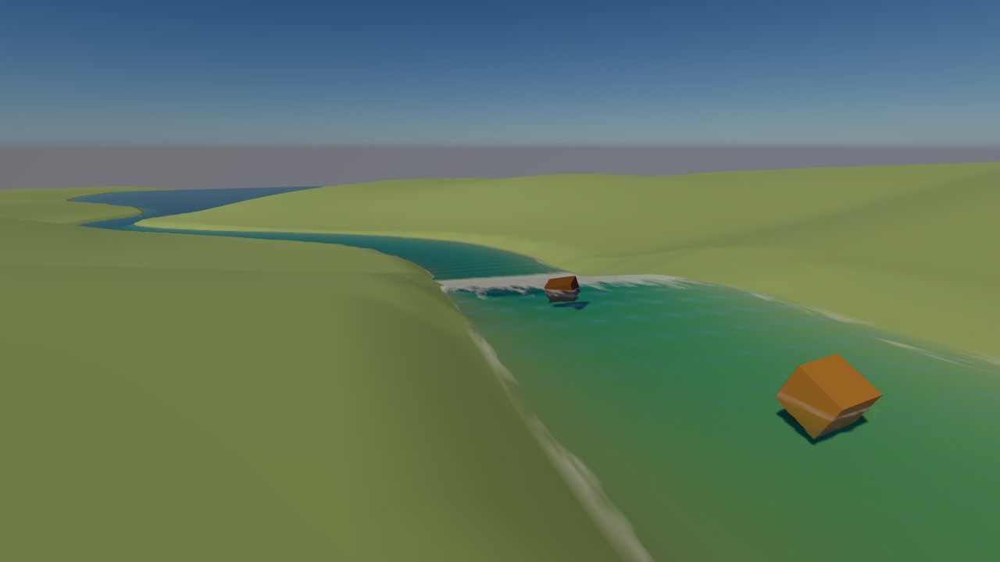
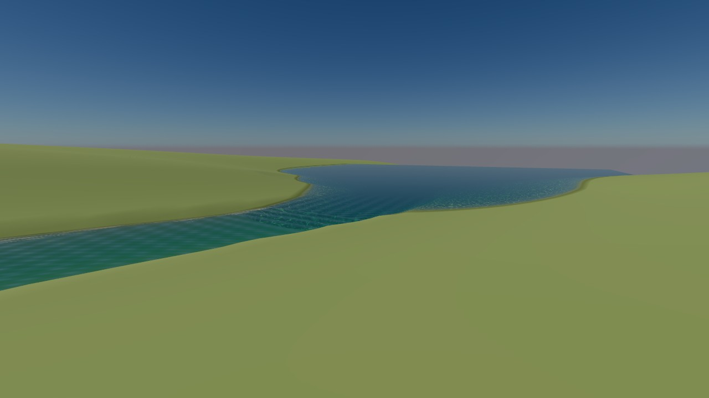
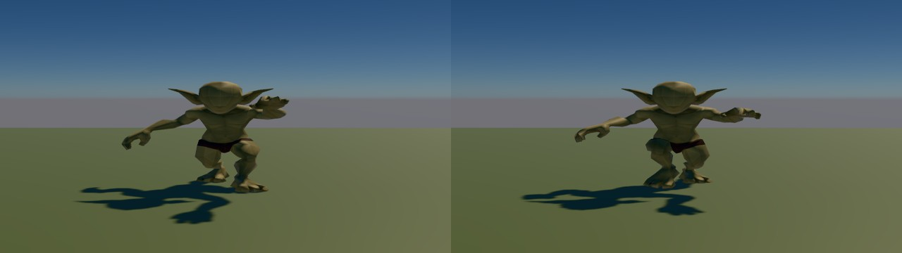

# NoorEngine Devlog #078 — Down the River

**Date:** 2026-11-20
**Build / commit:** Milestone 8D, part 6: rivers

## This week we actually did

**Rivers.** A `water` component can now be `"shape": "river"`: a list of points down the middle, each at the water's
height there, a width, a speed. The engine runs a smooth curve through the points and lays a ribbon of water along it,
level across and falling along. The water runs downstream:

- **you can see it:** ripples and foam are laid out along the river and slide down it at its speed, and foam gathers in
  white streaks where the surface falls steeply (rapids, from 8 cm a metre);
- **things float down it:** floating bodies are slowed toward the water's own velocity, so the current carries them at
  its speed, and a swimmer drifts with it;
- **scripts can read it:** `noor.water_flow(x, z)` in Lua and `Water.Flow(x, z)` in C# give the current's velocity.

*A river down a generated valley, a crate and a barrel riding it. The white line is where it drops over a steep stretch.*

*Where it runs into the lake.*

The test valley is generated: a 16-bit heightmap with a meandering channel, a steep stretch and a basin, worked out by
a little script, and the river's points come from the same function. In time a world generator should do that bit. Tom
suggested looking at Thornwake's world generator, which already does hydrology: lakes filled to their spill level and
rivers as networks of reaches, each a polyline with a falling surface and a width. That's almost exactly what this
river component takes, so it's in the ideas inbox as the obvious next step on the generation side.

## Build of the Week 🏆

**1.5 m/s, as promised.** The plan's proof: a floating crate carried downstream at the river's speed. In a river running
at 1.5 m/s, ten seconds after it's dropped in, the crate is doing 1.5 m/s to within 2%, with no sideways drift,
floating at the depth its density says. A swimmer who isn't swimming anywhere drifts 1.5 m in a second.

## Sage vs. Reality

**Foam everywhere.** I set the rapids to start at a slope of 3 cm a metre. The whole test valley falls 7 cm a metre, so
the whole river turned white. Now the white water starts at 8 cm a metre and only the steep stretch gets it. The foam
also came out as round blobs, which reads as froth on a pond; stretching the pattern along the current turned it into
streaks.

**The camera in the hill.** I raised the valley by 2.5 m and forgot the camera, which then rendered the inside of a
hill. Bad Ideas Works confirms the inside of a hill is grey.

## And: the goblin, in pictures

Tom gave the OK for pictures (the model stays on his machine). Here's his goblin, made, rigged and animated by him with
his own Blender add-on, playing its clip in NoorEngine at two moments. Tom says it has lumbago. It's the first character
in the engine that came from Tom's own hands, start to finish.

## What it isn't yet

- One speed per river, the same across it (real rivers are slower at the banks).
- No river is seen from underneath yet, and light under a river isn't dimmed (it's a box's and a sea's).
- No waterfalls: a steep stretch is a white slope, not falling water with spray and mist.
- No wet bank and no depth map for rivers (their level isn't one height).
- The editor has no spline tool for rivers: points are edited as numbers in the Inspector (the Water panel is part 7).

## Next engineering target

**8D, part 7: the Water panel and debug views.** A gallery of presets (Lake, Pond, Sea, Tropical, Swamp, River, Deep
sea), live editing, and debug views for depth, flow, waves and cost.

## Bad Ideas Works Award for Questionable Decisions

**Winner:** Generating an entire valley, with a hill, so a box can float down it.
**Defence:** Two boxes.
