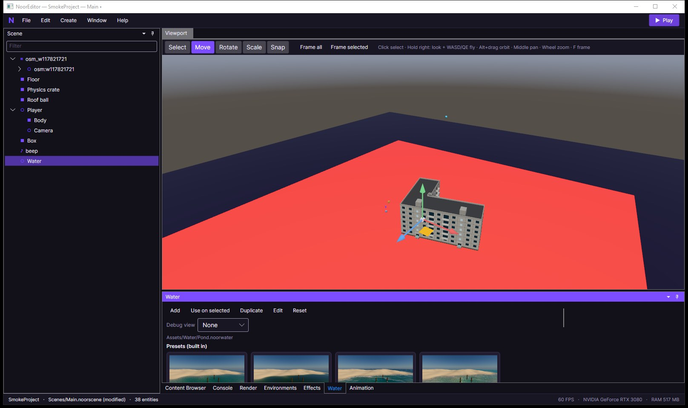
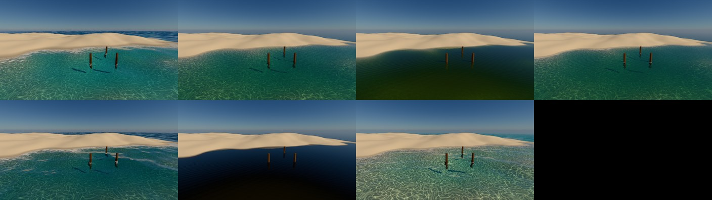

# NoorEngine Devlog #079 — The Water Panel

**Date:** 2026-11-20
**Build / commit:** Milestone 8D, part 7: the Water panel and debug views

## This week we actually did

**A Water panel**, next to Environments and Effects, and it works the same way: a gallery of looks with pictures. Pick
one, then **Add** (a new 20 × 20 m surface with it) or **Use on selected** (the selected water gets the look and keeps
its own shape: a box's size, a sea, a river's course). A built-in look is copied into the project the first time
(`Assets/Water`), so you can change it without touching the original. **Edit** lists every setting; change one and the
viewport follows at once, and so does a game that's playing. **Duplicate** and **Reset** do what they say.

*The smoke test editing a lake: milky red water, applied live. (The test's choice of colour, not ours.)*

**Seven looks:** Lake, Pond, Sea, Tropical, Swamp, River and Deep sea. Four of them are new this week: a murky green
pond, a clear turquoise lagoon with bright caustics, a dark brown swamp you can't see into, and a quick green-blue river.

*The gallery's pictures, rendered by a script from the engine's own presets (top: Deep sea, Lake, Pond, River; below:
Sea, Swamp, Tropical).*

**Debug views**, for when water looks wrong and you want to know why:

- **Depth:** how much water is under each pixel, pale in the shallows and dark blue at 5 m, with a line every metre;
- **Flow:** which way and how fast the water runs, with stripes running downstream;
- **Waves:** how far the waves lift the surface (red) or lower it (blue);
- **Normals:** which way the surface faces;
- **Cost:** how hard each pixel worked, counted as reflection-march steps (the expensive part): green barely, red all 20.

*Depth, flow, waves and cost. Top left, the depth lines draw the coast's shape.*

## Build of the Week 🏆

**Live edits reach a playing game.** Change a setting in the panel while the game runs and the water changes in the
game too, because gameplay and drawing both read the look's file. Which is how I found that they were reading it from
disk **every frame**, ever since part 2. Now each file is read again only when it changes.

## Sage vs. Reality

**The red tint that wasn't.** The smoke test had to see an edit change the viewport, so I made the water's tint bright
red, and nothing happened. Correct, as it turns out: a red tint means white light turns red as it goes through the
water, and the floor under it was dark blue, which red water turns black. Red water you can see needs red light
scattered back, so the test sets the scatter colour instead.

**Z-fighting in the smoke test.** Create ▸ Water put the test lake exactly at floor height, so the floor and the water
fought over every pixel, which looks like camouflage. The test lake now floats 30 cm up.

## What it isn't yet

- Settings are edited as text (numbers, `#RRGGBB` colours): no sliders or colour pickers yet.
- No spline tool for rivers: their points are still numbers in the Inspector.
- The gallery's pictures all show the same coast, so a river look is shown as a sea.
- The cost view counts the reflection march only; the Render panel's pass timings give the milliseconds.

## Next engineering target

**8D, part 8: the sample and the review.** Hillside gets its water for real: the lake with Alden at the shore, crates
bobbing, rain on the water, a river, a cost table, and the 8D review.

## Bad Ideas Works Award for Questionable Decisions

**Winner:** A smoke test that checks the editor works by turning a lake red.
**Defence:** It's very easy to see.
