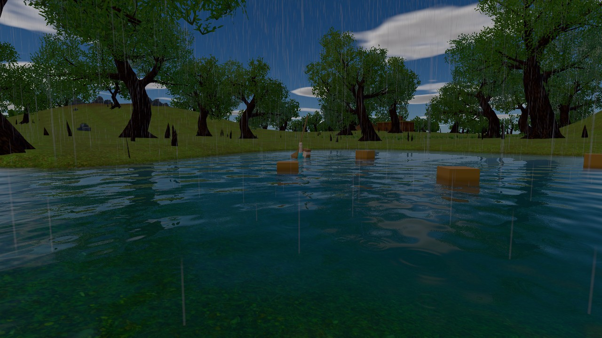
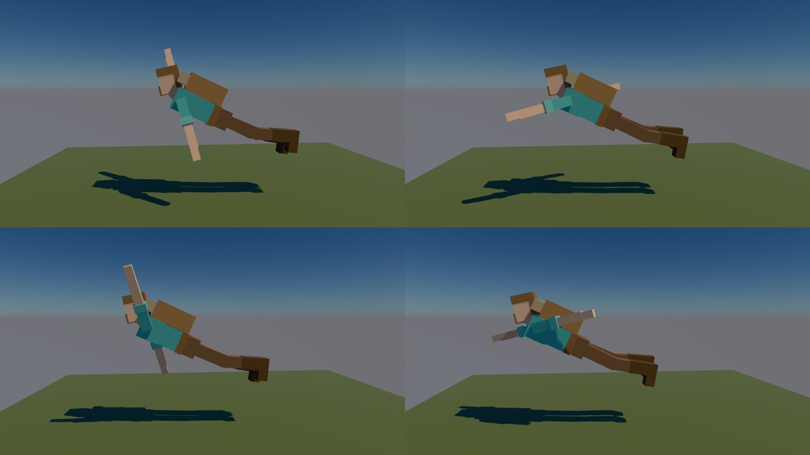
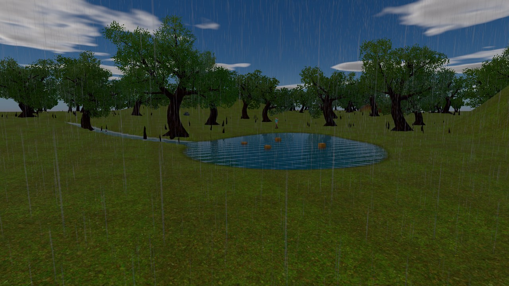

# NoorEngine Devlog #080 — Alden Learns to Swim

**Date:** 2026-11-20
**Build / commit:** Milestone 8D, part 8: the sample and the 8D review

## This week we actually did

**Water on Hillside, all of it at once.** The new sample scene, `Hillside_Water`, puts every part of 8D to work in one
place. It's the Hillside lake in light rain, with rain rings on the water. A stream comes down the slope south-west of
the lake, in a channel carved by the sample's own script (it checks the bed is under the water and the banks above it),
and runs into the lake. Four crates of different densities float, each at its own depth, bobbing in the ripples. And
Alden Wayfarer walks a loop straight through it all: he wades in (slowing as the water deepens), swims across the deep
middle, and walks out the other side.

*Ten seconds in: Alden mid-lake. A golden test, and the built Hillside game plays it to the bit.*

**Alden can swim.** The water plan promised him a generated swim clip, and here it is: `SwimForward`, a front crawl
built by the same script that builds him. His body tips 65° forward, each arm turns a full circle half a stroke apart,
the legs flutter-kick, and the hips move forward 0.72 m a stroke so root motion carries him. His controller gained a
Swim state; his script switches it from `on_water`, the event his character controller sends when the water gets
deep. He still holds his staff, so it sticks up out of the water like a periscope. We kept it.

*The stroke, a quarter of a second apart.*

*The stream joining the lake (an earlier camera).*

## Build of the Week 🏆

**The 8D gate passes.** Eight parts, each tested and pushed: surfaces, waves, shorelines and reflections, underwater,
floating and swimming, rivers, the Water panel, and this sample. Fourteen new golden pictures, and a built game that
matches the editor to the bit wherever gameplay touches water (buoys, floating crates, splashes, Alden swimming). The
review is in [M8D_REVIEW.md](../milestones/M8D_REVIEW.md), with its exceptions written down.

And with it, **Milestone 8 is done**: sky and environments, particles and sprites, skeletal animation, water.

## Sage vs. Reality

**What floating costs.** Part 5 left floating's CPU cost unmeasured. A hundred crates on the lake add about 1.9 ms of
game update: roughly 20 µs a crate, because each is 27 little cells and each cell asks the water's height every step.
A few floating things are cheap; a harbour full of them isn't yet. That's an exception in the review, with the fixes
in the ideas inbox.

**A number I can't explain yet.** The valley without any water draws its opaque scene slower than the valley with the
lake. Without water the camera looks at the lake's dry hollow and its grass, and Alden walks instead of swimming, but
I haven't pinned down which of those it is. It's in the review as an open question, not explained away.

**Nine bones, now eleven.** The old Alden check counted 9 posed bones. The swim stroke also moves his neck and head,
so his controller now touches 11. The test was updated; his walk on the old scene is unchanged (its golden matched).

## Alden discovers ...

**... that he can swim.** Alden halfway across a lake in the rain, front crawl, staff up like a periscope, crates bobbing
round him; below, the water goes green, then dark, and something long and patient is down there, watching. (Noor's
picture to come, as is the tradition.)

## Next engineering target

**Milestone 9: deep procedural world building**, per the spec: roads, architecture, cities, vegetation ecology and
simulation. It starts with a proposal, as Milestone 8 did. Thornwake's world generator, with its lakes and rivers, is
on the list of things to bring to it.

## Bad Ideas Works Award for Questionable Decisions

**Winner:** Letting the mascot swim with a two-metre wooden staff in his hand.
**Defence:** Nobody told him to let go.
