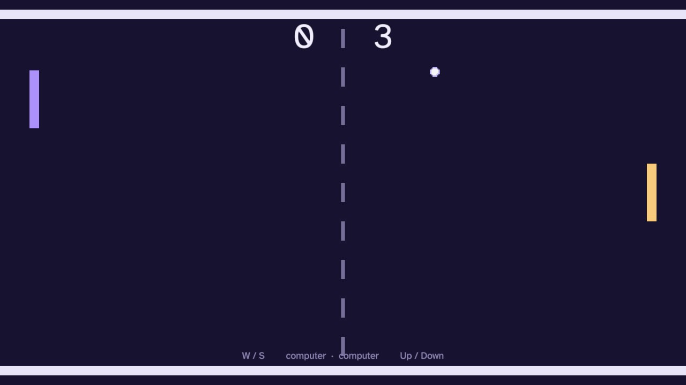

# NoorEngine Devlog #081 — Pong Is a Feature

**Date:** 2026-11-20
**Build / commit:** Milestone 9A, part 1: orthographic cameras, NoorPong and the yardsticks

## This week we actually did

**Milestone 9 has a plan, and a rule above it.** Tom and Noor answered the proposal with a principle that now opens the
plan: NoorEngine is a general-purpose engine. Everything Milestone 9 adds (big streamed worlds, generated land, roads,
villages, forests that grow) is optional, and a small game must not pay for any of it. Their test case: "if someone
wants to make Pong using NoorEngine, they absolutely should be able to."

So the first thing Milestone 9 built is Pong.

*NoorPong, the computer playing itself. Every pixel of it is drawn by the same renderer that draws Hillside's lake.*

**It needed a camera we didn't have.** Until this week every NoorEngine camera was a perspective one, so a true 2D
game couldn't be made at all. A camera can now be **orthographic**: it looks in parallel, so things keep their size
however far away they are. That sounds like one matrix, and the matrix was the easy part. Everything else that assumed
"the camera is a point" had to learn otherwise: shadow cascades (now boxes, not slices of a pyramid), culling, levels of
detail, the lighting's view direction, particles, the sky, sprites (they now face the view's direction, not a point),
and the editor's picking and gizmos. **Create ▸ Camera (2D)** makes one.

**NoorPong** is a whole game in one Lua script: bats, a pixel-art ball sprite drawn pixel by pixel by its generator
script, a score on the HUD, and a computer that plays either side until you press that side's keys. It isn't a perfect
player: it aims off-centre to angle its shots and gets less sure as the ball speeds up, so points do get scored. It all
moves at the fixed 60 Hz step, so the built game plays the same twenty seconds as the editor, to the bit (a test checks).

## Build of the Week 🏆

**The yardsticks.** Four projects that Milestone 9 will be measured against after every part: a single cube, NoorPong,
NoorFPS-lite and Hillside. For each, the player now reports what it costs: CPU per frame, GPU per frame, memory, GPU
memory, threads, and how long until the first frame. The baseline is written down, and a test fails if a project gets
slower or bigger beyond its margin. To prove the check has teeth, one test adds a deliberate 1 ms stall to the cube's
every update and passes only if the check catches it. It does: 1.15 ms against a limit of 0.45.

## Sage vs. Reality

**The smallest game isn't that small.** Measuring a single cube for the first time: 196 MB of RAM, 30 threads, and
117 MB of GPU memory, the same as a 3D scene. Most of the GPU memory is render targets every game gets whether it needs
them or not: multisampled HDR, a copy of the scene for water, and four big shadow maps (allocated even when Pong has
shadows turned off). Nothing new broke this; it was always there, and it's exactly what principle 0 is about. It's in
the ideas inbox with a fix.

**I guessed wrong about Hillside.** I'd written that Hillside spends its 6 ms of CPU a frame gathering the scene, which
is what 9A part 3 was going to fix. Then I looked at the numbers: gathering is 0.17 ms. Building the draw list from it
is 5.1 ms, mostly the scattered forest, tree by tree, every frame. The plan's part 3 now covers the draw list too.
Measure, then write.

**Pong's first draft was boring.** The computer was so good that the first rally lasted 25 seconds. Then it was so bad
that one side won 9–0. It kept its aim from the last fast rally into the next serve, so the receiver kept missing.
Now it picks a fresh aim every serve, and the score after a minute is 3–4.

## Alden discovers ...

**... the second dimension.** Alden, flattened into a sprite, stands at the edge of a Pong table, staff raised like a
bat, while a small white square comes at him. Somewhere a gold bat looks worried.

## Next engineering target

Tom wants 2D, 2.5D and isometric games to be possible too, before going back to big 3D worlds. The proposal is in the
[Milestone 9 plan](../milestones/M9_PLAN.md): 2D physics (Jolt locked to a plane, one physics engine instead of two),
sprite sorting by layer, tilemaps (square, isometric, hex), the editor in 2D, pixel-perfect cameras with parallax, and
a small platformer and an isometric scene as the proof. Then 9A part 2: coordinates for big worlds.

## Bad Ideas Works Award for Questionable Decisions

**Winner:** Starting the "deep procedural world building" milestone by making Pong.
**Defence:** The milestone's first rule is that small games still work. Pong is a small game. It works.
