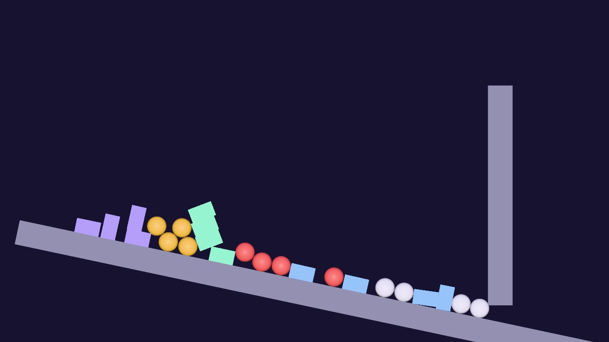

# NoorEngine Devlog #082 — Flatland

**Date:** 2026-11-20
**Build / commit:** 2D foundations, part 1: 2D physics on Jolt

## This week we actually did

**A plan for 2D.** Tom wants 2D platformers, top-down games and Diablo-1-style isometric games as well as 3D ones, and
asked me to pick the order. The [2D plan](../milestones/M9_2D_PLAN.md) has seven parts: physics, a platformer
character, sprites sorted by layer, tilemaps, a 2D editor view, pixel-perfect cameras, and two samples.

**The big decision** ([ADR-040](../decisions/ADR-040-2d-and-isometric.md)): 2D lives *inside* the 3D engine rather than
beside it. Some engines keep a separate 2D world with its own physics engine, renderer and editor. That gives exact 2D
physics, but it means two of everything and scenes that can't mix 2D with 3D. In NoorEngine, the 2D world is simply the
XY plane, seen by the orthographic camera from last week. 2.5D, 3D models in a 2D game, comes free.

**2D physics on Jolt.** A body marked `"plane": "xy"` can only move in X and Y and turn about Z. That's Jolt's own
feature, so there's still one physics engine, which keeps games deterministic and built games identical. 2D shapes
(`rectangle`, `circle`, `polygon`) are thin slabs, so bodies in the same plane always meet.

*Twenty-four rectangles and circles, four seconds after being dropped. A golden test.*

## Build of the Week 🏆

**A circle rolls at 2.23677 m/s².** Down a 20° slope, the textbook says a rolling disc accelerates at ⅔ g sin 20° =
2.23681 m/s². NoorEngine's circle does 2.23677: within 0.002%. That number only came out right because of the next
section.

## Sage vs. Reality

**My own decision record was wrong for a few minutes.** Jolt has no 2D circles, so a circle is a sphere: it touches the floor
exactly as a disc would. I wrote that it "rolls like a disc" too. Then, writing the test, I worked out the physics: a
ball spins more easily than a disc (its weight sits closer to its middle), so it rolls ⁵⁄₇ g sin θ, about 7% faster.
Circles now get a disc's inertia, the record says so, and the test checks against the disc formula with the ball's
number printed beside it.

**The test that proved nothing.** The first "everything fell" check counted bodies below 2.5 m. Two of them had landed
at the high end of the tilted floor, which is higher than that. Now each body is checked against its own starting
height. Also, a test asserting that locked bodies stay in their plane needs a control: the same pile *unlocked* drifts
out by more than a centimetre, so the lock is doing the work, not luck.

**A semicolon, again.** ctest splits test names on `;`, so a test with one in its name silently runs nothing. The repo
has had a guard for that since 8D, and it caught me. That's what the guard is for.

**Two red tests that weren't the engine.** The first full run with last week's yardsticks failed two tests. NoorFPS-lite
took 9 s to its first frame, against a limit of 1.6 s, because it ran straight after the suite builds that sample's C#
code: build servers still busy, disk cache cold. The next launch took 0.7 s. The yardsticks now warm up with a short
launch before measuring. And the editor's smoke test failed its play-mode checks, which need keyboard focus in the
editor window, while the machine was busy and in use. Alone it passes (123 s). Both are written down rather than
waved away: a test that fails for reasons outside the engine still costs trust, so it gets fixed or explained.

## Alden discovers ...

**... that he's been flattened.** Alden in profile, paper-thin, trying to walk "into" the screen and bumping his nose on
the plane, while a red circle rolls past him with suspicious confidence.

## Next engineering target

**2D part 2: a platformer character.** Walking and running on slopes, jumping higher the longer you hold the button,
one-way platforms you can jump up through, coyote time (a jump still counts a moment after you've run off a ledge) and
jump buffering (a jump pressed just before landing still happens). These are the small kindnesses that make platformers
feel fair.

## Bad Ideas Works Award for Questionable Decisions

**Winner:** Teaching a 3D physics engine to live in two dimensions.
**Defence:** It took one line to keep it there. The circles took a little longer.
