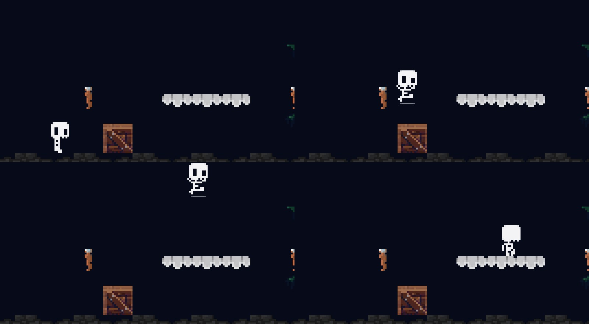

# NoorEngine Devlog #083 — Coyote Time

**Date:** 2026-11-20
**Build / commit:** 2D foundations, part 2: a platformer character

## This week we actually did

**A character that feels like a platformer.** Last week bodies learned to live in a flat plane. This week the character
controller did too, and then it learned manners. A 2D character (`"plane": "xy"`) walks along X only and can't leave
its plane: not on any of 150 test steps walking up a slope. Then come the settings that separate a platformer that
feels fair from one that feels broken:

- **Acceleration and deceleration**, on the ground and in the air, so a character has a little weight to it.
- **Variable jump height:** hold the button for the full jump, tap it for a hop.
- **Coyote time:** a jump still counts for a moment after you've run off a ledge. Named after the cartoon coyote who
  keeps running in mid-air until he looks down. Players never notice it, but they notice when it's missing.
- **Jump buffering:** a jump pressed a moment *before* landing happens when you land, instead of being lost.
- **One-way platforms:** jump up through them from below, stand on them, and press down + jump to drop back through.

All of it is off by default, so every 3D character moves exactly as before (there's a test for that too).

**And a built-in player.** A `platformer` component makes a character playable with no code at all: keys walk and
jump it, it turns its sprite the way it's moving, and it plays idle, run, jump and fall animations. A script can steer
the same character instead, and the facing and animations still follow.

*Tom's own pixel art from an old game of his, running on NoorEngine's new controller (a local demo, driven by a small
script). The art stays out of the repository; Tom cleared it for the devlog.*

## Build of the Week 🏆

**A jump that peaks where you said.** Ask for a 1.5 m jump and the textbook gives you a launch speed: √(2gh). In a game
that steps 60 times a second, that jump peaks about 4% short. Each step moves with the speed at the *end* of the step,
which is a little slower than at its start, so every step loses a sliver of height. NoorEngine solves for the speed that
peaks exactly at your height with our step size. The test measures 1.50091 m. When a level designer says "this ledge
is jumpable", it is.

## Sage vs. Reality

**Two of my tests were wrong, not the controller.** One expected the walker to finish high up a slope; it had walked
up, over the top and off the far end, so now the test checks the highest point it reached. The other guessed how high a
tap would go and guessed too low: a tap reaches about half the full jump, which is right.

**The demo's autopilot couldn't jump.** My script for playing the demo hands-free launched at 14 m/s with triple gravity:
a 3.3 m leap that cleared everything and landed on the wrong wall. Then it drifted right past the planks. It now jumps
with the controller's own speed and steers more gently. The engine was fine; the robot pilot needed lessons.

**A line under his feet.** In the jump frame there's a thin white line just below the skeleton. That's NoorEngine's
fault, not the art's: pixel-art sprites are sampled with "repeat", so the very edge of a frame can pick up the
opposite edge, or the next frame in the sheet. The next part (sprites for 2D) fixes it, and it's written down in the
plan.

## Alden discovers ...

**... coyote time.** Alden runs off a cliff edge, notices nothing, keeps running on thin air for a tenth of a second,
jumps, and lands safely on the other side, looking pleased with himself. Below, a coyote holds up a sign: "Hey!"

## Next engineering target

**2D part 3: sprites for 2D.** Sorting by layer instead of distance (in 2D, the artist decides what's in front),
sorting by height on screen for top-down and isometric views, soft-edged sprites, unlit sprites that show their own
colours, and frames that stay inside their own rectangle.

## Bad Ideas Works Award for Questionable Decisions

**Winner:** Naming a physics setting after a cartoon coyote.
**Defence:** Every platformer developer already calls it that. We just wrote it down.
