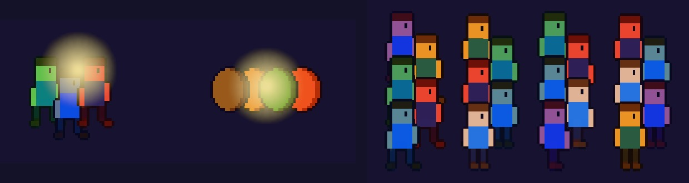
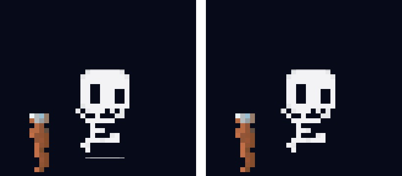

# NoorEngine Devlog #085 — Who Stands in Front

**Date:** 2026-11-20
**Build / commit:** 2D foundations, part 3: sprites for 2D

## This week we actually did

**In 3D, depth decides what's in front. In 2D, the artist does.** A 3D renderer asks "which is nearer?" for every pixel.
In a 2D game every sprite usually sits at the same depth, so that question has no answer: two overlapping sprites
flicker or come out in whatever order the GPU happened to draw them. 2D engines give the artist the say instead:

- **`layer`** and **`order`**: background on layer −1, characters on 0, foreground leaves on 1; within a layer, a
  higher order is drawn later, so in front. Godot calls this `z_index`.
- **`"sort": "y"`**: for top-down and isometric games, the lower a sprite stands on screen, the nearer it is. A
  character walks behind a tree, then down past it and in front of it, with nobody writing any code. Godot calls it
  Y-sort.
- **`blend`**: soft edges, for glows, smoke and painted art.
- **`unlit`**: the sprite's own colours, exactly as drawn, whatever the lighting. Pixel art often wants this.

*Left: walkers listed in the scene in the wrong order, drawn by their layers; coins by their order; soft glows blended
over them. Right: a crowd listed top to bottom, drawn with the lowest nearest.*

Sprites that don't ask for any of this are drawn exactly as before (lit cut-outs, depth-tested), which is right for
sprites standing in a 3D world. Every one of the 75 existing golden pictures came out the same.

## Build of the Week 🏆

**The line under the skeleton's feet is gone.** Devlog 083 showed a thin white line under Tom's skeleton in his jump
frame. The cause: pixel-art sprites are sampled with "repeat", so the very bottom of a frame picked up pixels from its
top. Sprites now sample half a pixel inside their own frame, so neither the opposite edge nor the next frame in the sheet can leak in.
A new test magnifies a frame sitting right next to a solid red one and counts the red pixels in the picture: zero.

*Before and after, on Tom's art.*

## Sage vs. Reality

**The glass would have framed every sprite.** NoorEngine's see-through pass was written for glass, and glass keeps
reflecting the sky even where it's perfectly clear. A soft-edged sprite drawn that way would have shown a faint
rectangle round itself wherever it's transparent, because those pixels still reflected. Sprites now use "coverage":
where a sprite isn't, nothing of it is drawn, reflections included. Glass still works as glass.

**A comment that lied.** The renderer's header still said see-through blending "is not implemented yet: drawn like
cutout". It has been implemented since Milestone 5. It says what's true now.

**Same depth, random order.** For an orthographic camera, "back to front" was measured as distance from the camera's
position, so two sprites at the same depth were ordered by how far each sat from the middle of the screen. For a
parallel view the see-through pass now measures depth along the view, so sprites at one depth keep the order they
came in.

## Alden discovers ...

**... that he can stand behind a tree.** Alden in a top-down forest, half hidden behind a trunk, then one step down
the screen and suddenly in front of it, looking at the tree as if it moved.

## Next engineering target

**2D part 4: tilemaps.** A tileset made from a sprite sheet, maps in square, isometric and hexagonal grids, drawn in
batches rather than one sprite per tile, with colliders built from solid tiles. The thing Tom's old Godot game used
103 times.

## Bad Ideas Works Award for Questionable Decisions

**Winner:** Spending a whole part deciding who stands in front.
**Defence:** In 2D, that's half of what drawing is.
