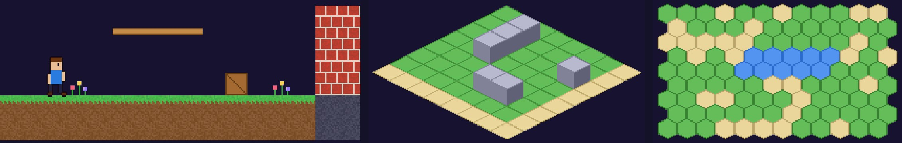

# NoorEngine Devlog #086 — Tiles

**Date:** 2026-11-21
**Build / commit:** 2D foundations, part 4: tilemaps

## This week we actually did

**Tilemaps.** Almost every 2D game since the 1980s is built from tiles: small squares (or diamonds, or hexagons)
picked from one picture and laid out in a grid. Tom's old Godot game used its TileMap 103 times. NoorEngine has them
now, in three shapes:

- **Square**, for platformers and top-down games.
- **Isometric**: the 2:1 diamonds of the classic isometric RPGs, where tall tiles (walls, blocks, trees) rise above
  their diamond and hide what's behind them.
- **Hexagonal**, for strategy and board games.



*The three layouts, with tiles drawn by the generator script (ours).*

**A map you can read.** A tilemap stores one line of text per row, top row first, `.` for empty:

```json
"rows": [". . . 4 4 4 . .",
         ". 5 . . . . 6 .",
         "0 0 0 0 0 0 0 0"]
```

It looks like the level. When you change one row, the history shows one changed line.

**Collision that adds up.** The solid tiles of a square map become as few boxes as cover them exactly: a floor 200 tiles
long is one box, not 200. One-way tiles become the jump-through platforms from part 2. And when a script breaks a block
(`e:set_tile(x, y, -1)`), the boxes are rebuilt by the next physics step. A test stands a character on the tiles, breaks
the one under his feet, and watches him fall.

## Build of the Week 🏆

**46,000 tiles in 64 draws.** Drawing one sprite per tile would ask the graphics card 46,000 separate times a frame for a
256 × 256 map. NoorEngine gathers each 32 × 32 block of tiles into a single mesh, so that map is 64 draws, about 0.6 ms
of CPU a frame, and the meshes are only rebuilt when the map changes. A test keeps it that way.

## Sage vs. Reality

**The first tilemaps were invisible.** No error, no warning: just a dark screen. The engine's gather step, which
collects what a scene shows, skipped any entity that didn't have a component type it already knew about, and `tilemap`
was new. One line fixed it, and the lesson is in the changelog: a silent skip is the hardest bug to see.

**Ghost lines over the isometric map.** Faint vertical lines rose from some diamonds, with little ticks on top. The
cause is a classic: with multisampling (four samples a pixel, for smooth edges), a pixel on a tile's edge is coloured
at its centre, and that centre can sit just outside the tile, so its picture position runs into the neighbouring tile
in the sheet. The textbook fix is "centroid" sampling: colour such a pixel from a point inside the part it actually
covers. That changes every mesh, not just tiles, so every golden picture was run again. One changed: the Forest, where
1.4% of pixels at leaf edges came out slightly differently, impossible to tell by eye. Its reference was updated and
the reason written down.

## Alden discovers ...

**... that the world is made of squares.** Alden on a pixel-art grass ledge, prodding the edge of the tile in front of
him with his staff; it falls away and he looks down into the gap, then back at us.

## Next engineering target

**2D part 5: the editor in 2D.** A proper 2D view (pan and zoom, no orbiting), snapping to pixels or tiles, and
painting tiles with the mouse, with undo, so maps stop being typed by hand.

## Bad Ideas Works Award for Questionable Decisions

**Winner:** Storing a map as lines of text.
**Defence:** You can read it, diff it, and fix it in Notepad. Try that with a binary blob.
