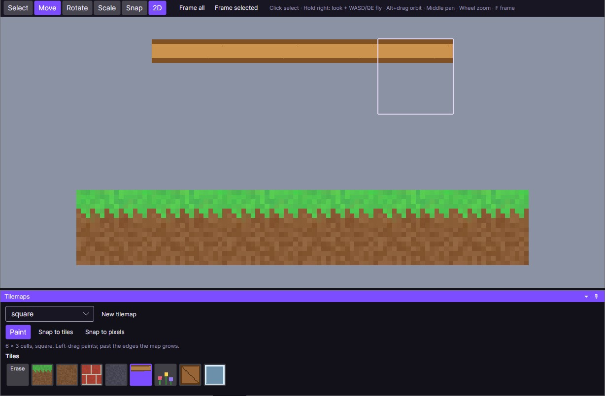

# NoorEngine Devlog #087 — Painting Tiles

**Date:** 2026-11-21
**Build / commit:** 2D foundations, part 5: the editor in 2D

## This week we actually did

**Maps stop being typed by hand.** Last week's tilemaps were made of text rows, which is lovely for diffs and terrible
for drawing a level. Now the editor paints them:

- **A 2D view.** A button in the viewport's toolbar points the editor's camera straight down at the flat XY plane, with
  no perspective. The right or middle button drags the view along with the pointer, and the wheel zooms in on whatever
  is under the pointer (it stays put while everything else grows), the way image editors do.
- **The Tilemaps panel.** Pick a tileset, press New tilemap, then pick a tile from the palette (the tileset's own
  pictures, kept pixel-crisp) or the eraser.
- **Painting.** Drag in the viewport and every cell the pointer crosses gets the tile. The cell under the pointer is
  outlined (a square, a diamond or a hexagon, by the map's layout), and **a whole drag is one undo step**, so a slip of
  the hand is one Ctrl+Z.
- **Maps that grow.** Paint past the edge and the map grows to meet you. Paint to the left or below and the map's
  origin moves back by the same number of cells, so everything you already painted stays exactly where it was.

*From the editor's own smoke test: the 2D view, the palette, and a row of planks painted with one drag.*

## Build of the Week 🏆

**The test paints like a person.** The editor's smoke test now makes a tilemap, switches to the 2D view, picks the
plank, and drags a simulated pointer across the map (never the real mouse). Then it checks that exactly the four cells
the pointer crossed were painted, that it was one undo step, and that one undo takes it all back. If tile painting
ever breaks, the build says so the same day.

## Sage vs. Reality

**The test that couldn't find what it had just made.** The new API test created a tilemap, then couldn't find it in the
scene. The scene was right there. The bug was a classic C++ trap in my test: looping over a part of a temporary JSON
value, which is thrown away before the loop starts. (The newest C++ standard fixes this; the compiler here doesn't yet.)
The test now keeps the value in a variable first.

**My own docs pointed at a menu that doesn't exist.** I first wrote "Window ▸ Tilemaps". The Window menu has no list of
panels; the Tilemaps panel is a tab at the bottom, beside Water. Checked, and the docs now say so.

**Answered along the way:** Tom asked whether a game can run full screen at the screen's own resolution and still
look like a lower one, as Godot's stretch modes do. Not yet. It's now the heart of part 6: a base resolution scaled up in
whole pixels, a render scale for 3D, fullscreen and window settings.

## Alden discovers ...

**... the level editor.** Alden standing in mid-air over an unfinished map, watching a giant cursor lay planks under
his feet one tile at a time, just in time for each step.

## Next engineering target

**2D part 6: resolution, display and cameras for 2D.** Fullscreen and window settings; a base resolution with
Godot-style stretch modes (a 320 × 180 game shown full screen in exact 6 × 6 pixels); a render scale for 3D; cameras
that land on whole pixels, follow the player with a dead zone and stay inside the level; parallax layers.

## Bad Ideas Works Award for Questionable Decisions

**Winner:** A map that moves itself when you paint to the left of it.
**Defence:** So nothing you painted moves. The map moves so the tiles don't have to.
