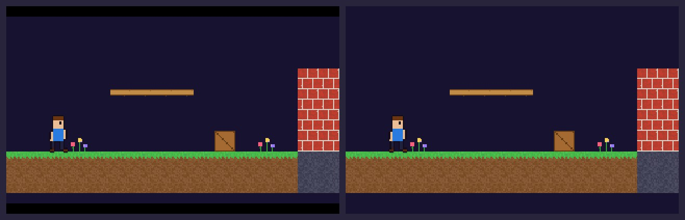
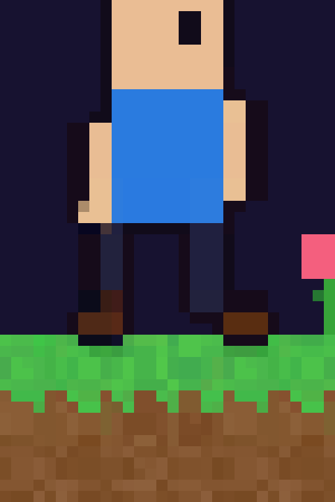

# NoorEngine Devlog #088 — Big Pixels

**Date:** 2026-11-21
**Build / commit:** 2D foundations, part 6: resolution, display and cameras for 2D

## This week we actually did

**Tom's question from last week, answered.** Can a game run full screen at the screen's own resolution and still look
like a lower one, the way Godot's stretch modes do? Now it can, and a project says how in one small file,
`Settings/display.json`:

- **A base resolution.** Design the game at 320 × 180 and say `"stretch": "viewport"`. The scene is drawn at exactly
  320 × 180 and blown up with nearest filtering, so every game pixel becomes a crisp block of screen pixels: 4 × 4 at
  1280 × 720, 6 × 6 at 1920 × 1080.
- **Whole steps only.** On a 1366 × 768 laptop the honest scale is 4.27, which would make some pixels 4 wide and some 5
  (pixel art hates that). With `integer_scale` (the default) it stays 4 × 4 and the picture is centred, with thin black
  bars.
- **Bars or more world.** A 16:9 game on a 16:10 screen gets bars above and below (`"aspect": "keep"`), or more of the
  level instead (`"expand"`): extra rows of game pixels of the same size, the camera seeing that much further up and
  down.
- **`canvas` mode** for smooth art and 3D: drawn at the screen's own resolution, laid out for the base one.
- **A render scale for 3D**: draw the scene at half the pixels and scale it up. On Hillside at 1920 × 1080, 0.5 took the
  scene pass from about 1.1-1.6 ms to 0.4-0.65 ms. (The machine was busy, so the numbers wobble; the drop doesn't.)
- **Fullscreen and borderless windows**, at the desktop's resolution, never switching the monitor's mode.
- **Cameras for 2D**: `pixel_snap` (scrolling in whole pixels, no shimmer), `camera_follow` (a dead zone, smoothing
  that's the same at any frame rate, level bounds the view never leaves) and **parallax layers** (`"factor": 0.2` for
  far hills that drift slowly behind the action).
- The HUD is laid out at the base resolution and scaled with the picture, so text designed for 320 × 180 is the size
  it was meant to be.

*Left: `keep`, 4 × 4 screen pixels per game pixel, bars above and below. Right: `expand`, same pixel size, more level.*

*A close-up of a real screenshot: each game pixel is exactly one block. The test checks every one of the 921,600.*

*The follow camera four seconds after the ball set off. The posts (factor 0.5) and the hills (0.2) have slid by
different amounts: that's the depth.*

## Build of the Week 🏆

**A test that counts pixels.** `render.display_stretch` plays a tilemap level with four display settings and reads the
screen back. In viewport mode every 4 × 4 block must be one exact colour (not one pixel off), the bars must be pure
black, and the `expand` picture's middle must be *identical* to `keep`'s picture, pixel for pixel. That last check is the
one that caught my bug.

## Sage vs. Reality

**Expand squashed the world.** My first `expand` drew 20 more rows of game pixels, but the camera still showed the same
10 metres of world, so those 10 metres got stretched over 200 rows instead of 180. The blocks were all perfect 4 × 4
squares (so the first test passed!), but the grass texture had become uneven: some texels 3 game pixels tall, some 4.
Looking at the screenshot, it was obvious. The fix: in `expand`, the camera's height grows with the extra rows. Then I
added the check that would have caught it: the middle of `expand` must equal `keep` exactly. It does now.

**A name clash.** I called the renderer's new setting `display`, and an old function already had a parameter called
`display`. The compiler (rightly) refuses to let one hide the other here. Renamed to `display_desc`.

## Alden discovers ...

**... that he's 4 × 4.** Alden, squinting at his own hand at 320 × 180, counting: "Four pixels. I used to have
fingers."
