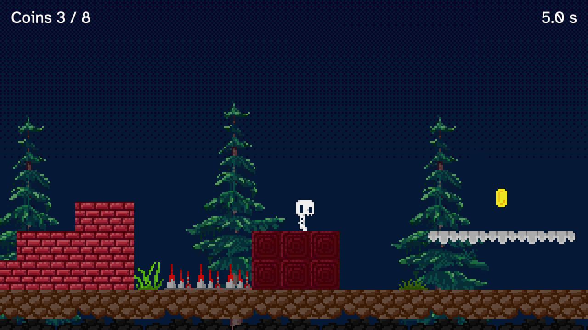
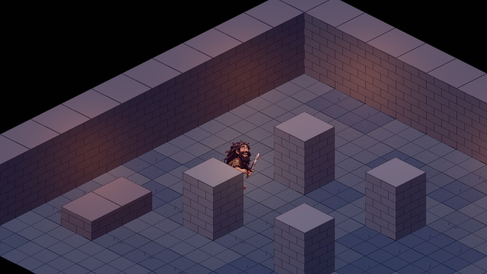
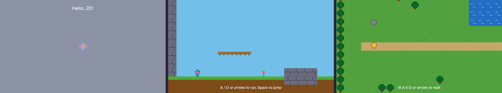

# NoorEngine Devlog #089 — A Level You Can Finish

**Date:** 2026-11-21
**Build / commit:** 2D foundations, part 7: samples, templates and the 2D review

## This week we actually did

**The 2D foundations are done.** Seven parts ago NoorEngine couldn't keep a box in a plane. Now it has two playable 2D
samples, three templates to start a game from, and a review that checks every piece for editor tools, runtime, saving,
docs, performance and tests.

- **NoorPlatformer.** A short level in Tom's own hand-drawn pixel art, from an old game of his, used with his
  permission. Run, jump, grab eight coins, mind the spikes, reach the door. It's 320 × 180 scaled up in crisp whole
  pixels, with a camera that follows and mountains and pines drifting behind. One Lua script is the whole game, and
  until you press a key an autopilot plays it.
- **NoorIsometric.** A torch-lit dungeon room in classic 2:1 isometric, with Coth from The Uncounted walking round the
  pillars in eight directions, a lantern light following him.
- **Templates.** New Project in the editor now asks what to start from: **Empty 2D**, **2D Platformer** or
  **Top-Down 2D**, each a small game that already works. On the command line it's `noor_cli new MyGame MyGame
  --template TopDown2D`.

*NoorPlatformer, five seconds into the autopilot's run.*

*Coth behind a pillar: its base hides his legs, his head shows above it. Every pixel is sorted.*

*Empty 2D, 2D Platformer and Top-Down 2D, each straight out of `noor_cli new`.*

## Build of the Week 🏆

**A test that plays the level.** `sample.noorplatformer_finishes` runs the platformer for fifteen seconds and passes
only if the HUD says "You made it!". It's not there for show. My first version of the level had a spike pit with walls
too tall to jump out of (fall in and you're stuck forever) and a plank bridge three metres up, when a full jump is 2.2.
The autopilot found both by getting stuck. Now every ledge is within reach, and if anyone ever breaks that, the test
says so.

**Small games got cheaper.** NoorPlatformer draws at 320 × 180, so its render targets are tiny: 0.36 ms of GPU a frame
and 68 MB of GPU memory, against NoorPong's 1.23 ms and 117 MB at full size. That was a worry from the 9A yardsticks
("small games pay for render targets they don't use"); for pixel-art games, part 6's base resolution answers it.

## Sage vs. Reality

**Tom caught a bug my tests couldn't.** Watching NoorIsometric, he noticed the floor covering Coth's feet for a moment,
quite often. Every golden I had was a still frame where Coth happened to stand clear of a tile edge. The cause: an
isometric floor tile sits by its centre, but its diamond reaches half a cell higher, so for the moment Coth's feet were
on the far half of the tile in front of him, that tile counted as nearer. The fix is Godot's own idea (a tile's "Y-sort
origin"): the tileset says which tiles are floor, and floors sit a cell further back. The new test walks a character over
every point of a tile and checks no floor ever ends up in front of its feet. Thanks, Tom.

**Seven parts of "8-direction sprites" and they didn't work in 2D.** A directional sprite picks its view from where it
faces relative to the camera, in the ground plane. Looking straight down at a flat game, that never changes. Now a
script can just say which way the character faces on screen (`"facing"`).

**A byte-order mark.** Editing a script with PowerShell saved an invisible marker at the start of the file, and Luau
refused the whole script. Notepad does the same thing. The engine skips it now.

**The editor had been carrying an old player for three days.** When I added the templates to the editor's build, the
smoke test couldn't find them. The editor's build was fetching its tools (the command-line tool, the game player) from
the *Debug* build folder, whatever build the editor itself came from. So the test editor had been packing games with a
player from 18 November. It's fixed, and a C# check that had started failing passes again: same cause.

**I almost published a name.** The first version of the platformer's generator read Tom's art by its original file
names, which include the old game's name, and that file goes into the public repository. The cutting step now lives in a
local script outside the repository; only the pictures went in.

## Alden discovers ...

**... the templates.** Alden at the New Project window, picking "Empty 2D", and finding himself flat: "I said *start
small*."
