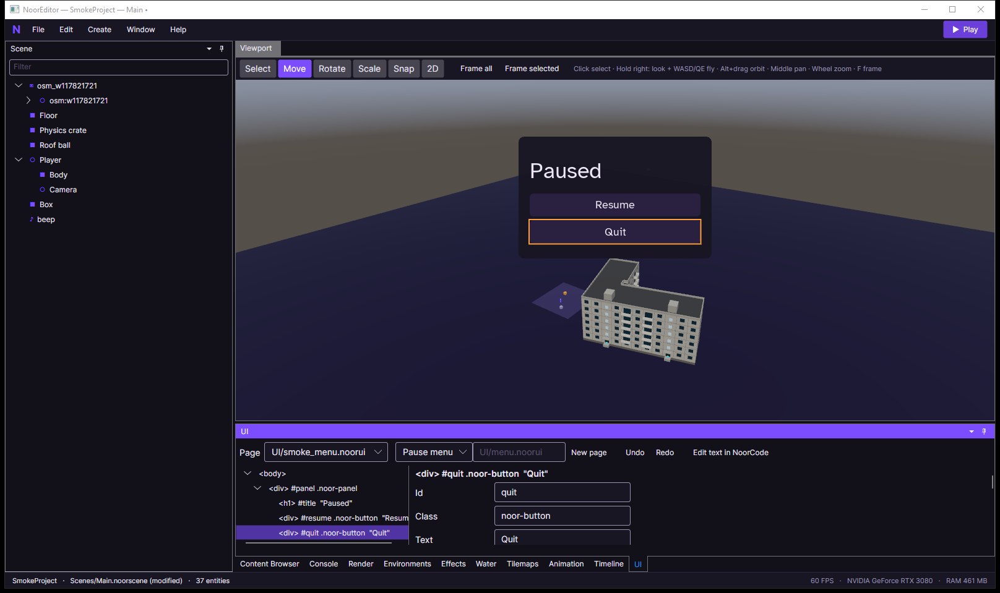

# NoorEngine Devlog #098 — The UI tab

**Date:** 2026-11-21
**Build / commit:** Gameplay foundations, part 6d: the UI tab

## This week we actually did

**Menus without markup.** Until now a menu meant writing HTML-ish text by hand. The editor has a **UI tab** now:

- **Start from a template:** a blank page, a pause menu (frosted glass, naturally), a HUD with a score and a health bar,
  or a settings screen with a name box, a volume slider and a checkbox.
- **See it while you build it:** the viewport shows the page over your actual scene. Click a button in the viewport and
  it's selected, outlined in orange, and its details are in the tab.
- **Change it:** id, classes, text, size, spacing, colours, font size, rounded corners. Add widgets from a palette
  (panel, title, label, button, image, slider, checkbox, text box), each with an id a script can use. Move them, delete
  them, undo, redo.
- **Use it:** **Put in the scene** gives an entity the page; press **Play** and it's in the game, in the editor too now
  (until this week, pages only showed in the player and built games).

*From the smoke test: a menu built in the tab on a blank page, the Quit button selected.*

The part I'm proudest of is invisible. The tab never rewrites a whole page. Every change (a colour, a new button) is a
small edit to exactly the right spot in the file. If you write half a page by hand, with comments and your own
formatting, and do the rest in the tab, your half stays exactly as you wrote it. Open the page in NoorCode while the tab
is working on it and both stay in step; the viewport follows the file either way.

There's also a **built-in theme**: palette buttons have hover, focus and pressed looks, and sliders and checkboxes have a
look at all. Out of the box, RmlUi's inputs are invisible until you style them, which is a lovely surprise for a
beginner.

## Build of the Week 🏆

**The smoke test builds a menu.** Like a user: a new blank page, a panel, a title, two buttons, their ids and text, a
width and a margin. Then it checks the file, finds the Quit button's outline in the viewport, clicks on Resume *in the
viewport* and checks Resume got selected, undoes and redoes, puts the page in the scene, presses Play, and sees the game
draw it.

## Sage vs. Reality

**A body in a comment.** My first test page had `<body>` in a comment inside its style sheet, put there on purpose. My
parser fell for it: it took the comment for the page's body and failed. The tests caught my own trap. Style sheets and
scripts are now skipped as text.

**The outline was under the menu.** I drew the selection's orange outline with the HUD overlay, which comes *before*
the UI in the frame. So the menu's own panel covered it, and it was barely visible in the first screenshot. The outline
is now part of the UI's frame, drawn last.

**One UI, two jobs.** RmlUi exists once per program, and the editor wanted two: a preview while building, and the game's
pages in Play. The viewport owns the only one and switches between the two jobs. Stopping Play had to be done in the
right order: the UI lets go of the game's world *before* the world is destroyed, on the right thread, without
waiting on the render thread.

**Stale numbers.** "After Stop the viewport shows the page again" failed once. The viewport reports its numbers twice a
second and the check looked after 300 ms. It polls now.

## Alden discovers ...

**... the palette.** Alden clicks Button. Then Button. Then Button again. A column of `button`, `button-2` and `button-3`
says Button, Button, Button. He renames them Left, Right and Jump, and the game, sadly, does nothing: buttons need
scripts.
