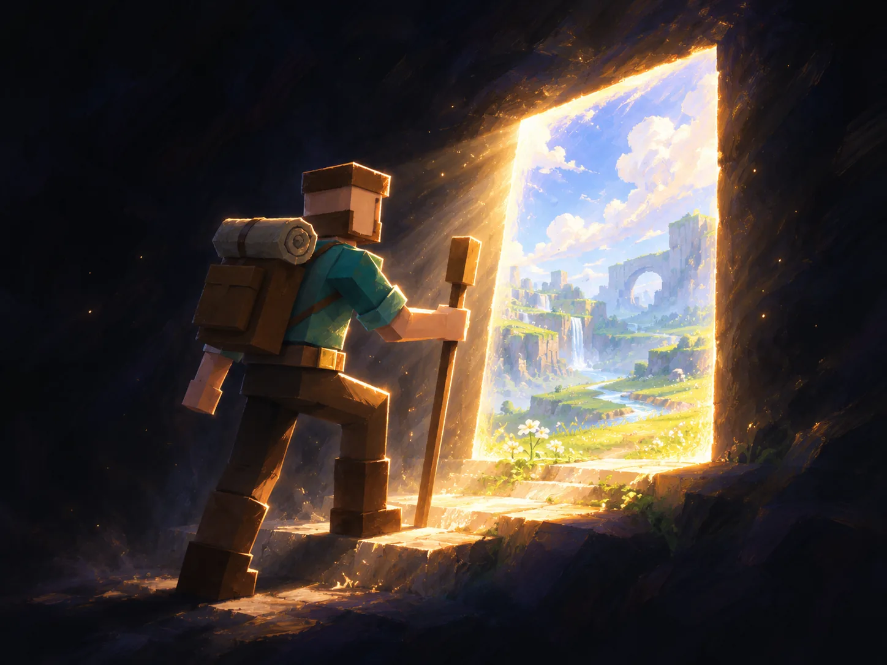

# Milestone 1 gate review: window, input, graphics device and first true viewport

**Date:** 2026-11-15 · **Reviewer:** Sage · **Verdict:** ✅ **Complete, with two documented exceptions**

Spec reference: master spec section 29, Milestone 1.

## Deliverables

| Deliverable (spec) | Status | Evidence |
|---|---|---|
| Window / monitor / input services | ✅ | `platform`: SDL3 window, events, keyboard (scancodes) + mouse input, relative mouse, display enumeration and moves |
| Device / swapchain | ✅ | Vulkan 1.3, sync2, dynamic rendering, FIFO swapchain, rebuild on resize/out-of-date |
| Resource management | ✅ | VMA; staged mesh upload with index validation; mesh handles; frame capture buffers |
| Shaders | ✅ | HLSL → SPIR-V with DXC at build time, warnings as errors |
| Basic mesh rendering | ✅ | Lit mesh pipeline, D32 reverse-Z depth |
| Camera | ✅ | `math` (ADR-022) + free-fly camera, 7 unit tests |
| Resize/minimize recovery | ✅ | Automated `lifecycle.window` test; no frames while minimized; live redraw while dragging |
| Color handling | ✅ | Linear shading, sRGB swapchain; `render.cube_pixels` checks the exact sRGB background |
| GPU diagnostics | ✅ | Validation layers + counted errors, GPU timestamps, CPU record time, debug labels and object names (RenderDoc), frame capture |
| Sample scene | ✅ | `noor_diag`: hero cube, ground, fly camera, `--cubes N` |
| Stress tests | ✅ | `stress.cubes_2500` (2,502 draws/frame, validation on) |

## Gate criteria

| Gate (spec) | Result | Evidence |
|---|---|---|
| Reliable lifecycle through **resize** | ✅ | `lifecycle.window`: 800×600 and back, swapchain follows; Tom resized by hand |
| … through **minimize** | ✅ | `lifecycle.window`: minimized, 0 frames presented, rendering resumes after restore |
| … through **monitor change** | ✅ | `lifecycle.window` on a 2-display machine: moved to display 2 and back, rendering continues |
| … through **application exit** | ✅ | Every GPU test tears down with validation on and counts errors after teardown: 0 |
| … through **device loss where recoverable** | ⚠️ **Exception 1** | Device loss is detected on every Vulkan call and reported as `ErrorCode::DeviceLost` with a plain-language message. Automatic recovery is **not** implemented |
| Visible mesh renders consistently | ✅ | `render.cube_pixels` reads real pixels each run; proven to fail when winding is broken |
| Build and graphics diagnostics are useful | ✅ | Structured logs, timings in title and exit summary, RenderDoc labels; used to find the validation-layer CPU cost in devlog #005 |
| Automatic smoke test runs | ✅ | 4 GPU tests locally (smoke, pixels, stress, lifecycle) + CI on every push (build + 32 non-GPU tests) |

## Exceptions (accepted, tracked)

1. **Device-loss recovery deferred.** Recovering means recreating the device and re-uploading every
   resource, which needs the asset system (Milestone 2) to know where resources came from. It also
   can't be tested reliably without a fault-injection tool. Tracked for Milestone 2–3; today's
   behaviour (clear error, clean exit) is safe.
2. **High-DPI scaling above 100% untested.** The window and swapchain use physical pixels and the
   code handles display scale, but the dev machine runs at 100%. Re-check when any machine with 125%
   or more is available. The lifecycle test will catch swapchain mismatches there automatically.

## Measurements (RTX 3080, 1280×720, 60 Hz)
- 2,502 draws/frame: CPU record 0.38 ms (Release, no validation), 9.0 ms with validation; GPU ≈0.06 ms.
- Viewport embedded in Avalonia (ADR-003 spike): 236 ms from creation to first frame.

## Carried into Milestone 2
- Device-loss recovery (exception 1).
- Instancing when real scenes need it.
- Deferred deletion instead of `vkDeviceWaitIdle` on mesh destruction; asynchronous uploads.
- Shared Vulkan device for multiple editor viewports (ADR-003 consequence).

## Alden discovers ...

**... light.** A dark, empty void, and one window opening onto it: Alden steps through, staff first, into the first frame NoorEngine ever drew.

*Picture: Noor (2026-11-20), for the milestone tradition (Noor's idea, devlog #015).* Added after the review, when the tradition caught up with the early milestones.
