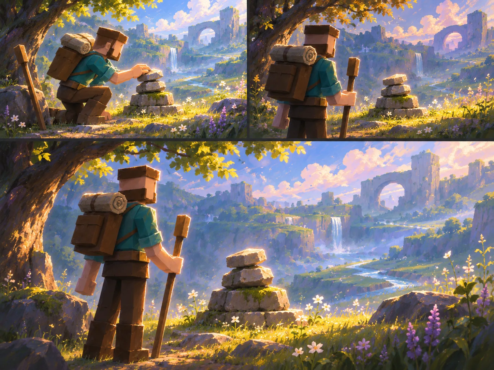

# Milestone 2 gate review: projects, assets and scenes

**Date:** 2026-11-15 · **Reviewer:** Sage · **Verdict:** ✅ **Complete, with documented exceptions**

Spec reference: master spec section 29, Milestone 2 ("Goal: save actual content reliably").

## Deliverables

| Deliverable (spec) | Status | Evidence |
|---|---|---|
| Project manifest | ✅ | `.noorproj` (ADR-005), version check, path-escape protection |
| Asset GUIDs | ✅ | `.noormeta` sidecars (ADR-006); Noor Interchange and prefab ids reused |
| Import registry | ✅ | `AssetRegistry`: scan, content hashes, move repair, duplicates, orphans |
| Textures / meshes | ⚠️ meshes ✅, textures **deferred** | GLB meshes, base colors, hierarchy, Noor extras. Textures need the material system (Milestone 5) |
| Scene / component document | ✅ | ADR-004; scene format 2 (layers, tags); unknown components preserved |
| Prefab basics | ✅ | ADR-024: instances, overrides, removals, propagation, nesting, variants, cycle detection |
| Serialization | ✅ | Deterministic JSON, atomic saves with `.bak`; byte-identical round trips tested |
| Save / reopen | ✅ | Unit tests and the CLI workflow save and reload scenes and prefabs |
| Undo/redo foundation | ✅ | `scene::History`: commands, transactions, save tracking; randomized invariant test |
| Resource hot reload | ✅ | `FileWatcher`; noor_diag reloads models, scenes and prefabs; shown live on Tom's machine |
| Error reporting | ✅ | `Result`/`Error` everywhere; validation groups issues; missing assets/prefabs named |

## Gate criteria

| Gate (spec) | Result | Evidence |
|---|---|---|
| A scene survives rename / move / reimport | ✅ | `M2 gate` unit test (rename in engine, move behind its back); CLI workflow moves the GLB and validates |
| Tests prove asset references remain intact | ✅ | Registry tests; `scene::validate` over the expanded scene; prefab expansion reproduces every mesh's world matrix exactly |
| Migrations / backups can be exercised | ✅ | Scene format 1 → 2 migration test (original kept as `.bak`); `noor_cli migrate --dry-run` / real run in CI |
| Command-line validation without the editor | ✅ | `noor_cli validate` runs in CI on every push (headless) |

## Exceptions (accepted, tracked)

1. **Texture import** deferred to Milestone 5 (PBR, HDRI, materials), where color spaces, mips
   and compression are decided together. BadBuilding's blockout buildings need only base colors.
2. **LOD files** (`.lod1.glb` …) are recognized by the registry but not loaded yet: needs a LOD
   selection system (Milestone 3+).
3. **`move_asset` doesn't move Noor Interchange side files** (manifest, recipe) with the GLB yet.
   GUIDs survive regardless; the side files are needed only for regeneration.
4. **Adding new child entities inside a prefab instance's expanded tree** is not supported yet
   (ADR-024 consequence). Overrides and removals are.
5. **Carried from Milestone 1:** device-loss recovery (the asset registry now provides what it
   needs: every GPU resource can be re-imported from its GUID).

## Measurements
- Street demo: 4 BadBuilding prefabs, 12 instances: 12 authored entities → 412 after expansion,
  334 draws, 56,306 triangles; Debug + validation: CPU record 1.7 ms, GPU 0.02 ms (RTX 3080).
- Tests: 80/80 (Debug, incl. 5 GPU tests), 75/75 non-GPU (Release); CI green.

## Carried into Milestone 3 (NoorEditor base application)
- The editor uses `scene::History` for every edit, `expand_prefabs` for display, the registry for
  the content browser, and `FileWatcher` for live updates.
- A shared Vulkan device for several viewports (ADR-003 consequence).

## Alden discovers ...

**... that the world remembers.** He sets a stone on a cairn, walks away, comes back the next day, and it's still there, exactly where he left it.

*Picture: Noor (2026-11-20), for the milestone tradition (Noor's idea, devlog #015).* Added after the review, when the tradition caught up with the early milestones.
