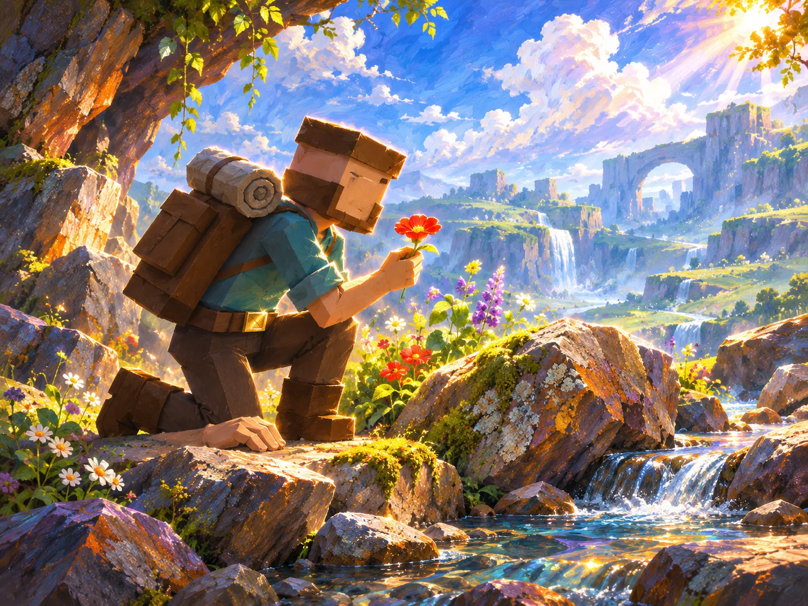

# Milestone 5 gate review: PBR lighting, HDRI and materials

**Date:** 2026-11-17 · **Reviewer:** Sage · **Verdict:** ✅ **Complete, with documented exceptions**

Spec reference: master spec section 29, Milestone 5 ("Goal: make the engine visually credible
and artist-friendly"). Plan: [M5_PLAN.md](M5_PLAN.md).

## Deliverables

| Deliverable (spec) | Status | Evidence |
|---|---|---|
| Calibrated PBR path | ✅ | ADR-012: HDR (RGBA16F) frame, physical units (lux, nits, lumens, EV100), GGX/Smith/Schlick BRDF, Khronos PBR Neutral and ACES tonemapping. [PBR.md](../rendering/PBR.md) |
| Material assets | ✅ | ADR-030: `.noormat` with instances (parent + overrides, 16 deep, loops refused), opaque/cutout/see-through, GLB materials with embedded images, a GPU material table, hot reload |
| Texture set import | ✅ | ADR-029: PNG/JPEG/TGA/BMP/HDR, kinds guessed from names, linear-light mips, BC7/BC5 compression, **Make material** from a set (works on Poly Haven sets as downloaded) |
| Material editor MVP with extensible graph architecture | ⚠️ MVP ✅, graph designed only | Part 6: live preview (shapes, HDRIs, exposure), every field, instances with overrides, undo. ADR-030 keeps the data contract open for a node graph; no graph editor yet |
| HDRI IBL | ✅ | Part 5: equirect `.hdr` → GGX-prefiltered cube + SH9 irradiance + BRDF table, cached |
| Sky/environment configuration | ✅ | `environment` component (HDRI, intensity, rotation, background) or a procedural sky from the sun's settings |
| Lighting/shadow controls and profiling | ✅ | Sun (4-cascade PCF, culled per cascade), point and spot lights, exposure presets, MSAA; GPU time per pass in the Render panel and in noor_player's report; [MEASUREMENTS.md](../rendering/MEASUREMENTS.md) |

## Gate criteria

| Gate (spec) | Result | Evidence |
|---|---|---|
| A PBR sample displays predictable materials under different HDRIs | ✅ | **PBR-Showroom** (`samples/PBR-Showroom`): gold and white roughness sweeps, six named materials and four textured sets under a sun and three HDRIs. `render.golden_Showroom_*` (4 scenes, Vulkan validation on). By eye: metals take the colour of each place, rough surfaces blur it, dielectrics keep their colour |
| The importer preserves colour spaces | ✅ | Colour maps are sRGB and averaged in linear light, data and normal maps are linear (unit tests: a 2×2 checker's mip is 188 in sRGB, not 128). The guess is by name and visible/editable in the texture settings tab. This review found and fixed a naming case that would have imported a colour map as data (below) |
| Changes serialize | ✅ | Materials save themselves to `.noormat` (editor smoke test), texture settings go into `.noormeta` (unit + smoke tests), scenes keep material ids; everything reloads in the editor and running games |
| Render tests detect regressions | ✅ | 13 golden-image scenes (320×180, ≤ 1% of pixels off by more than 12/255); `render.golden_catches_a_change` proves the judge fails on a different picture |

## What the sample found (fixed in part 8)

1. **Texture names with role words in them.** Poly Haven's `wooden_rough_planks_diff_1k.jpg` was
   guessed as a *data* map (because of "rough"), so its colour would have come out too dark, and
   **Make material** called the set "wooden". The **last** role word now decides, for the kind
   and for set names (unit tests with real Poly Haven names).
2. **A missed screenshot.** When the last frame of a `--frames` run wasn't presented (the
   swapchain was being rebuilt), noor_player had no picture for the test. It now draws the same
   frame again, with its HUD, until it gets one.

Found during part 7 and the texture-compression step, also fixed: the release build that
crashed because a pipe stopped the build halfway; and `set_environment` before the first
frame writing to descriptor sets that didn't exist yet.

## Exceptions (accepted, tracked)

1. **No material graph.** The spec's graph-based material workspace (nodes, layering, painting,
   decals) is designed for (ADR-030) but not built. Painting comes with CSG in Milestone 6.
2. **Light transport gaps:** no bloom (emissive looks flat), no reflection probes (metals reflect
   the environment, not the room around them), no shadows from point and spot lights, see-through
   materials blend rather than filter light (no transmission), no auto-exposure.
3. **Formats:** no `.exr` and no BC6H for HDR textures; no BC4 for single-channel maps.
   Compressed textures are not cooked into built games yet (they compress on the first start).
4. **Tonemapper:** AgX (the plan's first choice) waits for a licence check of its curve; Khronos
   PBR Neutral is the default.
5. **Editor:** one material preview per document (the tab in front owns it); no thumbnails in the
   Content Browser; exposure presets are a menu, not per-scene profiles.
6. **One GPU tested.** All GPU tests and goldens ran on one NVIDIA RTX 3080 (Windows 10).
   Integrated GPUs, AMD/Intel drivers and 4K displays are not measured yet; references might need
   per-vendor tolerance.
7. **Carried:** LOD loading, GPU device-loss recovery, prefab child edits, the automated HiDPI run
   (M3), and the M4 script API gaps (prefab spawning, timers, raycasts vs triggers).

## Measurements
- Tests: **191/191** (Debug, incl. GPU, editor and samples), including about 165 editor smoke
  checks with zero Vulkan validation errors.
- Golden-image render scenes: 13 (8 test scenes + Glass + 4 showroom scenes).
- GPU time at 1280×720 on the test scenes: 1–2 ms per frame; shadows are the largest pass; 4×
  MSAA costs a few tenths of a millisecond to ~1.5 ms and 42 MB.
- Textures: BC7/BC5 take a quarter of RGBA8. A real 1254² PBR set: 8 MB → 2 MB per map, ~1 s once
  to compress three maps (release), no visible difference. PBR-Showroom: 12 maps, 16 MB.
- NoorFPS-lite on its textured arena: 24 demo hits in C# and in Lua (15 s, no input).

## Milestone tradition: Alden discovers something
Proposed line for the Milestone 5 picture (Tom and Noor make it):
*"Alden discovers colour: the stones are rough, the buckle shines, and the sky lights the world."*

*Picture: Noor (2026-11-20), for the milestone tradition (Noor's idea, devlog #015).*

## Carried into Milestone 6 (manual creation tools)
- CSG brushes need surface materials and UVs: the material system and texture sets are ready;
  per-face material assignment and UV projection (box/planar) are new.
- Material/UV painting baseline: layering on top of `.noormat` (ADR-030's future graph).
- The Uncounted, Chapter Two (IDEAS.md) will want bloom, lamp shadows and reflection probes for
  interiors; worth ordering them by what its first level needs.
