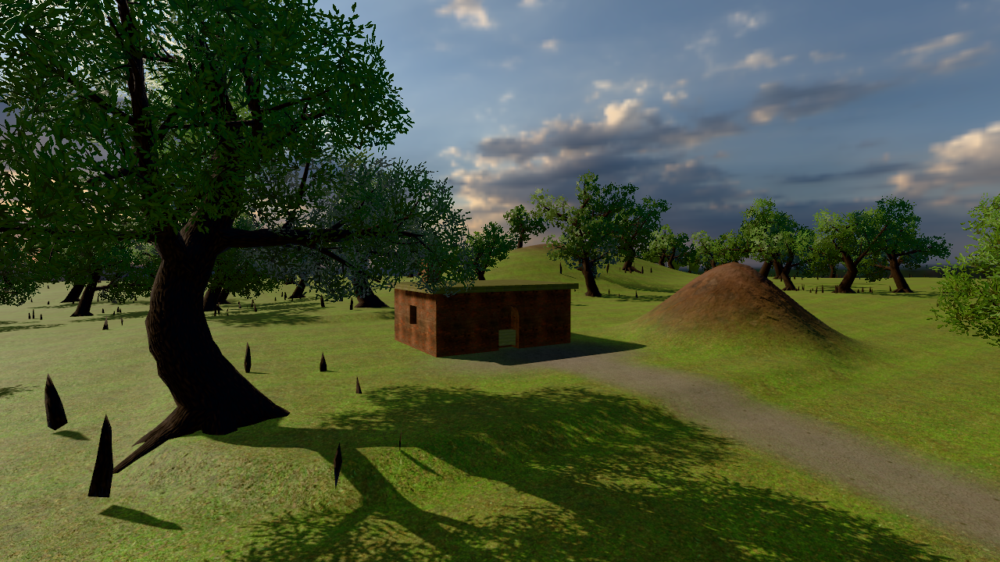

# Milestone 7 gate review: procedural graph and first generation tools

**Date:** 2026-11-18 · **Reviewed by:** Sage (engineering) · Tom and Noor to look at the forest.

**Goal (spec):** implement reusable generation infrastructure before many specialised generators.
**Verdict:** the gate passes. Terrain, trees and (since the same evening, when NoorMD rock exports arrived)
rocks are real clients of the graph. The exceptions are written down below.

## Deliverables

| Deliverable (spec) | Status | Evidence |
|---|---|---|
| Typed procedural node graph | ✅ | `.noorgraph` files, typed pins with units, a versioned node registry (15 nodes), validation with every problem on its node (ADR-014, [PROCGRAPH.md](../procgraph/PROCGRAPH.md)); a graph editor in NoorEditor (part 4) |
| Cache / invalidation | ✅ | Results keyed by type, version, parameters, seed stream and input keys, in memory and in `.noor/cache/procgraph`; tiles as regions (a node with bounds recomputes only the tiles it touches) |
| Seeds | ✅ | A stream per node (graph seed mixed with the node's id), per grid cell in scatter; no shared generator; deterministic maths only (+ − × ÷, square roots, hand-written sine/cosine) |
| Progress | ✅ | Worker threads with ordered results, progress per node, Cancel (nothing half-written is kept), per-node times and cache hits in the editor |
| Headless operation | ✅ | `noor_cli generate` and `cook`/`build`; the editor runs the same `procgraph::generate` |
| Terrain as a client | ✅ | Height-field nodes, masks, terrains built on a graph's output (cooked for games); sculpt and paint stay on top (parts 3, ADR-031) |
| Trees as a client | ✅ | NoorForm oaks imported through Noor Interchange (four levels, manifest, recipe, seed: part 5), drawn with instancing and levels of detail (part 6, ADR-032), placed by the `scatter` node with a hand-made layer (part 7) |
| Rocks as a client | ✅ (after the review, same day) | NoorForm cracked rocks (three levels, three convex collision hulls each), imported like the trees, placed by Hillside's graph where the rock was painted, colliding by their convex pieces placed or scattered. See "After the review" |

## Gate criteria

| Gate (spec) | Result | Evidence |
|---|---|---|
| Given fixed inputs and versions, outputs are reproducible | ✅ | Pinned fingerprints, the same in Debug and Release: `cli.generate` (hills `193a309d3ece274d`), `cli.generate_forest` (`4ef35d5bf74670fb`), `cli.generate_hillside_forest` (`d94d55ed79c3e3b3`, reads the paint layer). The editor and the CLI write identical bytes: `api.generate_matches_cli`, and on the sample `gate.hillside_forest_generate_equals_cook`. Threads never change results (unit test, part 2) |
| A local override survives regeneration | ✅ | Terrain: sculpting survives a new seed (`api: …terrain on a graph base…sculpting survives a new seed`). Instances: trees planted and removed by hand survive two reseeds (unit `scatter component: trees removed and placed by hand survive a new seed`, and the API test doing it through strokes, undo and Save) |
| Changed regions invalidate only appropriate results | ✅ | A stamp moved in one corner recomputes only that corner's tiles (unit test, tile keys compared, part 3); a changed setting reruns exactly the node and what depends on it (unit test, and the editor smoke test: "change one thing, run four") |
| Output can be used outside the generator | ✅ | Instance sets are plain JSON; `tools.instance_reader` reads them with a program that links no engine code. Height fields are a documented binary format (`.noorfield`). Built games use only cooked outputs: `noor_player` doesn't link the graph code (`boundary.runtime_has_no_editor_code`), and `player.hillside_walk` walks a built game through the graph's forest |

## The sample: Hillside grows a forest (part 8)

`samples/Hillside` now has 142 oaks of three NoorForm variants (Oak 01, 04, 07) placed by
`Assets/Graphs/forest.noorgraph`: a **paint mask** (the meadow the M6 sample painted, so nothing on
the dirt path or the rock), an **exclude** mask (a corridor along the path, the house's yard, the
camera's view of the house), three **scatter** nodes and two **merges**. A `Forest` scatter entity
draws it standing on the sculpted terrain, and its trunks collide in the built game. Added by
`tools/samples/add_hillside_forest.py` through the editor API, like the rest of the sample.

## What the sample found (fixed in part 8)

1. **`noor_cli generate` couldn't find assets.** It never gave the graph a way to look up asset
   files, so any graph reading one (the new paint mask, and the heightmap node since part 3) failed on
   the command line while the editor and `cook` worked. No test ran such a graph through `generate`.
   Fixed, and the pinned Hillside forest test covers it.
2. **Trees need their trunk where the trunk is.** Trunk collision uses each model's capsule node,
   which sits where the trunk really stands: about a metre from the oak's pivot (the part 5 finding).
   Collision from the pivot would have left invisible walls beside every trunk. The test aims at the
   capsule and checks the ground three metres away.
3. **A paint mask needs a threshold.** Raw meadow weight fades over a metre at the path's edge, so trees
   could stand right next to it; the graph maps 0.6–0.95 to 0–1 and adds a 10 m corridor.
4. **Root knees are very visible up close.** Every oak in the pack has `knees: 7`, so dark root knees
   stand around each trunk, prominently in the foreground of the sample's view. Authored content,
   noted for NoorMD (regenerating with `knees: 0` would remove them).

Found earlier in the milestone and fixed there: a quadratic scene walk (189 ms a frame for a 2,000-tree
forest, part 6), a collider losing its capsule size when a model was placed (part 5), a Rescan racing a
background graph run (part 4), smoke checks that counted triangles before culling existed (part 6).

## Exceptions (accepted, tracked)

1. ~~**No rocks.**~~ Closed after the review: see below.
2. **NoorMD's NoorEngine export mode doesn't exist yet.** The oaks were converted from a NoorForm pack
   by `tools/interchange/noormd_engine_export.py` (outside the engine), following the guide. When the
   mode lands, its own exports replace them, and the shared fixture moves into NoorMD's tests.
3. **Graphs place trees; they don't grow them.** There is no headless NoorForm, so a graph can't
   regenerate a tree from its recipe (open question 2 in the plan, NoorMD's call).
4. **Rendering limits:** levels of detail pop (no cross-fade) and have no hysteresis; forests made of
   entities cost CPU (about 6 ms for 10,000 entities), so big forests should be scatters.
5. **Graph editor MVP:** no zoom, subgraphs, comments or groups; graph edits are file edits with the
   tab's own undo (like the material editor), not scene commands (ADR-014 part 4).
6. **Plan items not done:** erode-lite and distance-to-path masks (the exclude node covers paths and
   clearings), a cache size limit, plugin-provided nodes (ADR-007), moving a single scattered tree,
   trees following live (unsaved) sculpting.
7. **The sample was extended by a script through the editor API**, like Milestone 6's (its exception 1).
8. **One GPU tested** (NVIDIA RTX 3080, Windows 10).
9. **Repository size:** NoorMD oaks add about 26 MB (one test fixture, three in the sample: about 6.5 MB
   each after conversion). The guide's suggestions (mesh quantization) would roughly halve the geometry.

## After the review: rocks and grass (2026-11-18, evening)

NoorForm exports arrived for **rocks** (nine cracked rocks, three levels, convex collision pieces) and **grass**
(short, tall, stylized clumps). What it took:

- **The converter** learned rocks (their collision pieces' flat keys become `extras.noor` blocks, the part is
  `detail`) and plants (grass packs say `"kind": "tree"`, but their recipe's archetype is `grass`: kind
  `vegetation.plant`, no trunk capsule), and single exports next to each other in one folder. The oak and
  rock fixtures stayed byte-identical through the changes.
- **Convex collision** in the physics (it was "unknown shape"): placed rocks collide by their hulls (which,
  unlike mesh colliders, may also move), scattered rocks too.
- **Scatter for grass:** a `draw_distance` (grass is drawn within 45 m), a `shadows` switch (grass casts
  none), and placements cached between frames.
- **Two bugs the grass found:** `terrain::Heights::shared` keeps only weak references, so in a game nothing
  held a scatter's ground between frames and **the terrain was rebuilt every frame** (25 ms with grass;
  present since part 7's ground snapping, hidden with few instances). The placement cache now holds the
  ground. And collecting a scatter copied every instance's matrix each frame: 50 ms in Debug for 20,000
  clumps (the built game's walk test timed out). The groups are now shared, not copied: 1.2 ms in Debug.
- **Hillside** has 24 rocks (three variants on the painted rock, a few in the meadow) and 20,179 grass
  clumps (short with tufts of tall, on the meadow around the house and the path). Golden updated.

New tests: rock import and convex collision (placed and scattered), the placement cache and the kept ground,
`gate.hillside_grass_generate_equals_cook`; the Hillside fingerprint is now `67a35a8fa217d253`.

## Measurements
- Tests: **280/280** (Debug, incl. GPU, editor, samples and built games), after rocks and grass.
- Golden-image scenes: 18 (16 from Milestones 5–6 + Forest, Scattered; Hillside updated with its forest).
- 2,000-oak forest (RelWithDebInfo, 1280×720, MSAA 4×): **5 → 60 FPS** (CPU about 9 ms, GPU 2.5 ms, 24
  draw calls, 0.43 M triangles), [MEASUREMENTS.md](../rendering/MEASUREMENTS.md).
- Hillside with its forest (RelWithDebInfo): GPU 5.5 ms, 81 draw calls (60 of them shadows), 0.49 M
  triangles, 60 MB of textures (the sample's PBR sets and the oaks' levels in view).
- Hillside with rocks and grass (RelWithDebInfo, 1280×720): **60 FPS** (vsync), CPU about 8.5 ms (collecting
  2.8 ms, building draws about 5 ms for 20,000+ instances), GPU 2.1 ms, 0.73 M triangles, 2,558 objects drawn
  after culling and the grass's draw distance. In Debug: about 50 ms a frame (draw building dominates).
- Graphs: the Hillside forest graph (9 nodes) runs in 7 ms (Release, no cache); the test forest's scatter
  of 4 ha in well under a second in Debug.
