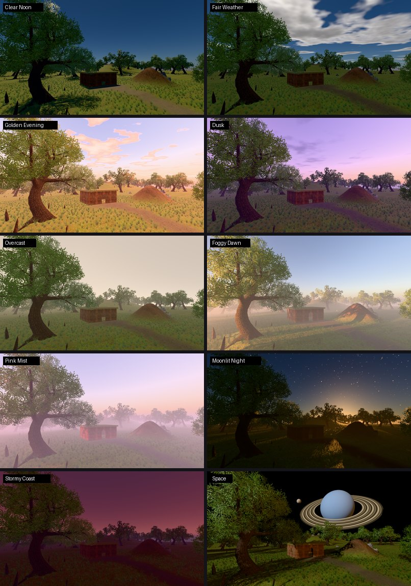

# Milestone 8A gate review: sky, atmosphere and environments

**Date:** 2026-11-19 · **Reviewed by:** Sage (engineering)

**Goal (plan):** NoorSky phase A: a sun-driven sky, aerial perspective and fog, environment lighting rebuilt on
the GPU so the sun can move, clouds, night and space, environment assets with presets and a gallery, weather zones.
**Gate (spec):** each system has editor authoring, runtime behaviour, serialization, docs, performance notes and
tests. A feature that merely draws something for a frame is not finished.
**Verdict:** the gate passes. Every system meets every column below, and the exceptions are written down. One plan
item, "low and high settings" in the performance notes, isn't met, because the engine has no quality settings yet:
exception 1.

## Deliverables (the plan's parts)

| Part | What | Status | Evidence |
|---|---|---|---|
| 1 | Atmosphere: a physically based sky from the sun (Rayleigh, Mie, ozone), the sun coloured by the air | ✅ | Checked against physics, not taste: hand-worked transmittance, Chapman's air mass, the CIE clear-sky zenith, ozone's blue twilight (`atmosphere:` unit tests); goldens `Atmosphere_Noon`, `Atmosphere_Sunset` ([ADR-033](../decisions/ADR-033-environments-and-atmosphere.md)) |
| 2 | Lighting from the live sky, on the GPU; `time_of_day` | ✅ | A port of the CPU reference, matching its goldens (mean difference 0.02 and 0.04 of 255); 0.16 ms a sun change, so dawn to dusk relights every frame at 60 FPS (`render.day_cycle`) |
| 3 | Fog and aerial perspective | ✅ | Far ground meets the sky without a seam (golden `Hillside_Haze`); fog maths against numerical integration; the aerial volume costs 0.025 ms |
| 4 | Clouds (layered) | ✅ | Two deterministic layers drifting with game time, shadows on the ground, overcast lighting (goldens `Atmosphere_Clouds`, `Atmosphere_Overcast`); 0.04 ms |
| 5 | Night and space | ✅ | Moon (phase, its light, the shadow light when it outshines the sun), stars, `sky: "space"`, planets with rings, extra suns, automatic exposure decided by measuring a day (goldens `Hillside_Night`, `Space`) |
| 6 | `.noorenv` assets, presets, the gallery | ✅ | Nine built-in presets (the plan said six; three good variants were kept), apply/duplicate/edit/reset in one undo step, never written; a custom environment builds into a game identically (`cli.environment_builds_identically`) |
| 7 | Weather zones | ✅ | A built game's camera walks into a fog bank: 540 frames smooth, monotone, identical to the project, 60 FPS (`cli.weather_walk`); scripts roll zones in and run the clock |
| 7b | Clouds with depth (added during 8A) | ✅ | Volumetric layers beside the flat ones ([ADR-034](../decisions/ADR-034-volumetric-cloud-layers.md)): reference shape and physics tests, golden `Atmosphere_Volume`, a built game identical, 1.51 ms |
| 8 | Sample and review | ✅ | This document; the sample below |

## Gate criteria, system by system

| System | Editor authoring | Runtime | Serialization | Docs | Performance notes | Tests |
|---|---|---|---|---|---|---|
| Atmosphere sky, time of day | Inspector (sky mode, fields), Environments gallery Edit | GPU live sky, rebuilt when the sun moves | `environment` component, `.noorenv` | PBR.md, ADR-033 | 0.16 ms a sun change; sky pass ~0.1 ms | unit (physics), goldens, `render.day_cycle`, CPU-path goldens |
| Fog, aerial perspective | the same fields | per pixel, aerial volume per frame | the same | PBR.md | 0.025 ms; fog negligible | unit (fog maths), golden `Hillside_Haze` |
| Clouds, flat | the same fields | sky pass, shadows, metering | the same | PBR.md | 0.04 ms | unit, goldens, `render.clouds_cost` |
| Clouds, volume | `cloud_type` drop-down | half-resolution compute march | the same (`cloud_type`, `cloud_thickness`) | PBR.md, ADR-034 | 1.51 ms (test scene), +0.7 ms on Hillside | unit (reference), golden, `render.clouds_volume_cost`, built-game check |
| Night, space, bodies, extra suns | fields; `celestial_body` and lights edited as components | sky pass, exposure | components | PBR.md | not measurable at this scale (part 5) | unit (moon, stars, exposure), goldens `Hillside_Night`, `Space`, `Hillside_Space` |
| Environment assets, presets | Environments gallery (pictures, Apply, Duplicate, Edit, Reset) | `{"asset": id}` resolved with overrides | `.noorenv` (versioned format) | PBR.md, ADR-033 | none needed (files) | API tests, smoke test, built-game check, nine sample goldens |
| Weather zones | Create ▸ Weather zone, environment picker | blended per frame by the camera | `weather_zone` component | PBR.md, ADR-033 | gathering the scene 0.5 ms with blending | unit (blend rules, weights, scripts), `cli.weather_walk` |

## The sample: Hillside under every sky (part 8)

`samples/Hillside/Scenes/Presets/` has the valley under each of the nine built-in presets, written by
`tools/samples/add_hillside_presets.py`. The script applies each preset **through the editor API**, exactly what the
gallery's Apply does, so the sample's `Assets/Environments` holds nine `.noorenv` copies that remember their preset.
A tenth scene, `Hillside_Space`, puts the same land, house and forest on an airless world: a black sky, a ringed
planet and a small moon over the valley, and a second, orange sun. All ten are golden renders.

## Performance notes

Measured on the sample by `tools/samples/measure_hillside_skies.py`: a whole frame (terrain, 142 oaks, 20,000 grass
clumps, the house, shadows) at 1280×720 on an RTX 3080, the fastest of 300 frames.

| Hillside scene | GPU per frame |
|---|---|
| Original (HDRI sky) | 1.17 ms |
| Clear Noon | 1.09 ms |
| Fair Weather (flat clouds) | 1.27 ms |
| Fair Weather with volumetric clouds | 1.97 ms |
| Golden Evening, Overcast, Pink Mist | 1.38–1.43 ms |
| Foggy Dawn, Moonlit Night | 1.50 ms |
| Dusk, Stormy Coast | 1.81–1.85 ms |
| Space (two suns, planet, moon) | 1.12 ms |

The sky features themselves are small. What changes between presets is mostly the shadows (a low sun throws long
ones across more of the cascades) and frame-to-frame noise of a few tenths of a millisecond. The one feature that
shows in the budget is volumetric clouds (+0.7 ms here, +1.5 ms on the test scene, which shows more sky). Feature
by feature, on the test scenes: sky pass about 0.1 ms; a sun change 0.16 ms; aerial volume 0.025 ms; flat clouds
0.04 ms; volume clouds 1.51 ms; night and bodies not measurable; weather blending 0.5 ms of CPU a frame
([MEASUREMENTS.md](../rendering/MEASUREMENTS.md)).

## What the sample found

1. **Stars don't show next to a sunlit valley.** `Hillside_Space` has stars, but the camera is exposed for land
   lit by a sun, and at that exposure stars are far too faint, just as for a real camera. That's correct, and the
   sample doesn't cheat it. A stylised "always show the stars" option would be a feature request, not a fix.
2. **Saving a scene leaves a `.bak` beside it**, and the sample's original `Hillside.noorscene.bak` had been
   committed by accident in Milestone 6. Untracked now, and `*.noorscene.bak` is ignored.
3. **Stormy Coast's storm doesn't read from Hillside.** Its dense, dark cloud cover blends into the red sky, so from
   the valley's camera (looking along the land, not up into the clouds) it's a crimson gradient, not a storm. It
   was tuned on the test scene, which looks up. Not changed here: it's the strongest case for the open question on
   volumetric presets below.
4. **Sky cost is dominated by the land under it.** The presets differ more by their sun's height (shadow length)
   than by their sky features, so a sky's price can't be read from its settings alone.

Found earlier in 8A and fixed there, all with tests: the night exposure bias added light instead of removing it;
half-float banding in night skies; planet rings always seen edge-on; overcast metered white (clouds' blocked light
treated as lost); a shared sky copy halving the frame rate; weather blending rebuilding the CPU atmosphere every
frame (20 FPS); a fully-on weather zone switching the sky off; volumetric cloud edges flattened by an over-eager
anti-sparkle fade.

## Exceptions (accepted, tracked)

1. **No quality settings.** The plan asked for each feature's cost "at low and high settings". There are no such
   settings yet; what a scene chooses decides the cost (flat or volume clouds, aerial perspective on or off).
   Quality levels belong with the editor and game settings work.
2. **Volumetric clouds are new and partial:** no preset uses them yet (to be decided from renders); edges are
   better but still too even (round two in the ideas inbox); seen from below and from the side only, no flying
   through; reflections see their flat coverage.
3. **The editor's viewport blends weather zones by the scene's camera**, not the view you fly.
4. **Not done from the plan or found along the way:** textured celestial bodies, eye adaptation over time,
   pictures for a project's own environments (they show their preset's), real lunar calendars, the remaining
   preset looks (phase B: Cold Morning, Autumn Afternoon, Rainy Grey, Desert Haze, Fantasy Crisp; Alien World in
   phase C).
5. **One GPU tested** (NVIDIA RTX 3080, Windows 10), at 1280×720.
6. **The sample was extended by scripts through the editor API**, like Milestones 6 and 7.

## Open questions

1. A "deep sea" environment without a water surface, before 8D's water? Asked, not answered yet.
2. Which presets, if any, should switch to volumetric clouds (Fair Weather, Stormy Coast and Golden Evening are the
   candidates)? To be decided from side-by-side renders.

## Measurements
- Tests: **351/351** (RelWithDebInfo, incl. GPU, editor, samples and built games).
- Golden-image scenes: 38, up from 18 at the end of Milestone 7 (8A added 20: the atmosphere at noon and sunset,
  clouds, overcast, volume, space, Hillside haze and night, the ten sample scenes, and two CPU-path checks), plus the
  test that the comparison catches a change.
- A whole Hillside frame under any sky: 1.1–2.0 ms of GPU (above).

## Next
**8B: particles and sprites** (rain, snow and dust for 8A's weather, FX, sprite sheets and 8-direction billboards
for The Uncounted's creatures), as the plan orders it.

## Alden discovers ...

**... the sky.** Alden sits on a hilltop as the sun goes down, layered clouds turning pink, the first stars coming out, and a planet rising in the distance.

*Picture: Noor (2026-11-20), for the milestone tradition (Noor's idea, devlog #015).* Added after the review, when the tradition caught up with the early milestones.
