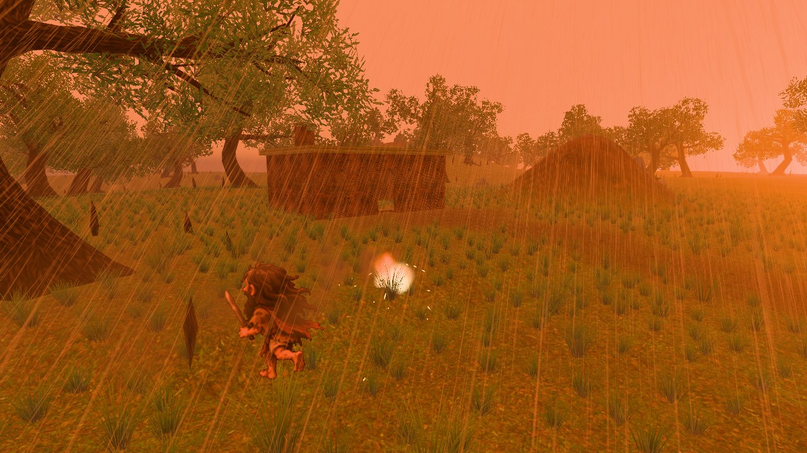

# Milestone 8B gate review: particles and sprites

**Date:** 2026-11-20 · **Reviewed by:** Sage (engineering)

**Goal (plan):** NoorFX, effect particles simulated deterministically on the CPU and drawn instanced; weather particles
(rain, snow, dust) for 8A's environments; an Effects panel with presets and a live preview; sprite sheets and
billboards, 8-direction characters for The Uncounted, animations and effects driven by scripts; collisions,
sub-emitters and budgets. ([plan](M8_PLAN.md), [ADR-035](../decisions/ADR-035-particles-and-sprites.md))
**Gate (spec):** each system has editor authoring, runtime behaviour, serialization, docs, performance notes and
tests. A feature that merely draws something for a frame is not finished.
**Verdict:** the gate passes. Every system meets every column below, and the exceptions are written down. The sample
found two real problems, both fixed with tests (effect particles ignored weather zones' wind; the particle system read
the environment file from disk every step), and one that stays an exception (automatic exposure doesn't see fire).

## Deliverables (the plan's parts)

| Part | What | Status | Evidence |
|---|---|---|---|
| 1 | Particle core: `emitter`, `.noorfx`, rates and bursts, shapes, lifetime, gravity, drag, wind, curves; deterministic | ✅ | The maths against hand-worked physics (`particles:` unit tests); a pinned fingerprint, the same in Debug and Release; a built game replays a campfire bit for bit (`cli.particles_build_identically`); 10,000 particles step in 0.02 ms |
| 2 | Drawing particles: instanced, facing or stretched, flipbooks, blending, lit, fogged, sorted with glass | ✅ | Goldens `Particles_Campfire`, `Particles_Campfire_Night`, `Particles_Glass`; 10,000 big smoke particles 0.58 ms of GPU (`render.particles_cost`) |
| 3 | Weather particles: rain, snow, dust from the environment | ✅ | Goldens `Hillside_Rain`, `Hillside_Snow`; the 8A weather walk starts the rain smoothly, the same in a built game (`cli.weather_walk`); 200,000 drops 0.18 ms |
| 4 | The Effects panel: module stack, curves, six presets, live preview | ✅ | API tests (presets run, apply in one undo step, edits reach the game, never the preset); the editor smoke test (the preview follows an edit at once) |
| 5 | Sprites: `.noorsprite`, the slicer, the `sprite` component, flipbooks | ✅ | Frames exactly on the grid (`sprites:` unit tests, `sprite api` tests); goldens `Sprites_Sun`, `Sprites_Shade`; the smoke test slices a sheet and previews the walk |
| 6 | 8-direction characters, animations and emitters from Lua and C# | ✅ | A walk round a circle checked frame by frame (every direction, one step at a time); walk, attack, end event, fall, at the same moment in the project, a built game and C# (`cli.sprite_scripts_build_identically`); golden `Sprites_Coth` |
| 7 | Gameplay particles: collisions, sub-emitters, budgets | ✅ | Particles rest on the terrain, never under it (unit tests, golden `Particles_Terrain`); exact sub-emitter counts and identical runs; 50 emitters asking for 150,000 hold at the 100,000 budget (`render.particles_cost`) |
| 8 | Sample and review | ✅ | This document; the stormy evening below |

## Gate criteria, system by system

| System | Editor authoring | Runtime | Serialization | Docs | Performance notes | Tests |
|---|---|---|---|---|---|---|
| Effect particles (simulation) | Effects panel (module stack, curves, gradients, seed), Inspector | `fx::ParticleSystem`, fixed 60 Hz, deterministic | `emitter` component, `.noorfx` (versioned) with overrides | PARTICLES.md, ADR-035 | 10,000 particles 0.02 ms of CPU | unit (maths, pinned fingerprint), built-game replay |
| Drawing | `render` module in the panel | one instanced draw per emitter, sorted with glass | the same | PARTICLES.md | campfire 0.005 ms, 10,000 smoke 0.58 ms | goldens, `render.particles_cost` |
| Weather particles | environment fields, weather zones, presets | worked out in the vertex shader | `environment` / `.noorenv` (`rain`, `snow`, `dust`, `wind_*`) | PARTICLES.md, PBR.md | 200,000 drops 0.18 ms | goldens, `cli.weather_walk` |
| Effects panel, presets | gallery, Add to scene, Duplicate, Reset, preview controls | the viewport's own preview simulation | project copies remember their preset | PARTICLES.md | preview is the same code games draw with | API tests, smoke test |
| Sprites | sheet editor (grid, world size, filter, animations, preview), Make sprite sheet, Place in scene | cutout cards turned to the camera, animated | `.noorsprite`, `sprite` component | SPRITES.md | not measurable at this scale (one mesh draw each) | unit, API, goldens, smoke test |
| 8-direction characters, scripts | Directions, Turns, a turnable preview | view from the camera angle; play/stop/speed, end events; bursts | the component (`started`, `speed`, `paused_at`) | SPRITES.md, LUA_API.md, CSHARP_API.md | 0 (a frame index) | unit (directions, circle walk, end events), C# ABI, built-game check, golden |
| Collisions, sub-emitters, budgets | Collisions and Sub-emitters modules, "Hide beyond" | collide after moving; children stepped with their parent; budget in scene order | `collide`, `sub_emitters`, `render.max_distance` | PARTICLES.md | 50 colliding fountains: CPU 1.0 ms, GPU 0.18 ms | unit, golden, `render.particles_cost`, smoke test |

## The sample: a stormy evening on Hillside (part 8)

`samples/Hillside/Scenes/Hillside_Storm.noorscene`, written by `tools/samples/add_hillside_storm.py` **through the
editor API**, as the editor would: the valley in the evening (the Dusk preset, the sun a little earlier), and a storm
that rolls in over four seconds (a weather zone a script fades in: rain, a strong wind, low cloud and fog). By the
house a campfire burns: the Fire, Smoke and Sparks presets applied as the Effects panel's Add to scene does, the sparks
landing and bouncing on the hillside, a lamp for its glow, and the smoke blown by the storm's wind. Coth, from The
Uncounted, walks round the fire: an 8-direction sprite on a character controller, following the ground and turning
with the camera. It's a golden render, five and a half seconds in, and the built Hillside game plays it exactly as
the project does: the same particles to the bit, the same spark landings, Coth walking (`player.hillside_storm`).

## Performance notes

Measured by `tools/samples/measure_hillside_storm.py`: the whole sample frame (terrain, 142 oaks, 20,000 grass clumps,
the house, shadows, the storm) at 1280×720 on an RTX 3080, the fastest frame of the best of three 400-frame runs, and
the particle simulation's CPU time a frame.

| Hillside scene | GPU per frame | Particle simulation (CPU) | Particles |
|---|---|---|---|
| Calm Dusk (no storm) | 1.93 ms | 0.09 ms | 107 |
| The storm, settled (zone fully on) | 2.05 ms | 0.13 ms | 107 |
| The sample (storm rolling in by script) | 2.91 ms | 0.12 ms | 107 |
| ... without rain / campfire / Coth | 2.84 / 2.59 / 2.55 ms | 0.11 / 0.09 / 0.12 ms | 107 / 0 / 107 |
| **Twenty campfires** (the particle-heavy benchmark) | 3.27 ms | 0.26 ms | 2,092 |

Read with care: on the whole sample, a run's fastest frame still swings by about ±0.4 ms from run to run (the same
scene measured 2.35 and 2.91 ms), so differences under half a millisecond aren't findings. What stands: the settled
storm costs about 0.1 ms over the calm evening; the rain, the campfire and Coth are each within the noise; twenty
campfires with their sparks colliding with the hillside add about 0.35 ms of GPU and 0.15 ms of CPU. The scripted
version measures higher, but a script that stops touching the zone once it's on measured the same (2.74–2.78 ms
against 2.35–2.91): noise, not a cost.

What 8B's features cost, feature by feature, on the test scenes (`render.particles_cost` and the unit tests): a
campfire 0.005 ms of GPU; 10,000 big alpha-blended smoke particles 0.58 ms; 200,000 raindrops 0.18 ms; 50 colliding
fountains, 98,750 particles (held to the 100,000 budget) 0.18 ms of GPU and 1.0 ms of CPU; 10,000 particles step in
0.02 ms without collisions. A sprite is one ordinary mesh draw. While a weather zone is changing (the storm rolling
in), the sky's tables are rebuilt every frame (8A's cost, about 1 ms here); once it's settled, never.

## What the sample found

1. **Effect particles ignored weather zones' wind** (fixed). The rain blew in the storm, the campfire's smoke stood
   straight up: effects took their wind from the scene's own environment only. Games now hand NoorFX the wind the
   weather has (`game::effect_wind`: the environment with its zones blended in, judged from the camera), tested.
2. **The particle system read the environment file from disk every fixed step** (fixed by the same change: the
   environment is cached by file and time, as the sky's is). About 0.05 ms a frame of nothing.
3. **Automatic exposure still doesn't see fire.** The Fire preset is tuned for daylight; in a dark evening the camera
   opens up and the fire blows out to white. The sample turns its glow down with an override (emission 600, sparks
   3,000), as the night campfire test does. An exposure meter that counts local light is in the ideas inbox.
4. **A sprite on a character goes at the character's origin, its feet.** The first try put Coth's picture half a
   capsule lower, half into the ground. The engine was right (the docs say feet); the sample script was fixed.

Found earlier in 8B and fixed there, all with tests: mirrored sprites lit from behind (a negative scale turned the
card's front away); weather zones blending cloud wind the long way round; a C# `JsonValue` made from an int not giving
a double (the sheet editor's preview stuck on frame 0); sub-emitters not muted with their entity.

## Exceptions (accepted, tracked)

1. **Collisions are with terrain and planes only.** Boxes, models and other physics bodies don't stop particles (a
   raycast per particle would blow the CPU budget). Sub-emitters are one level deep. The scene budget is a fixed
   100,000 (no per-scene setting yet); the editor's preview has none.
2. **Automatic exposure ignores local light** (found in part 2, again in the sample): bright effects need their glow
   chosen for the scene's light.
3. **Not in 8B, as planned:** the effects node graph and timeline (the module stack covers 8B's effects), trails and
   ribbons, mesh particles, GPU-simulated particles (not needed at the measured costs), soft particles against scene
   depth, force fields, tilemaps and the 2D workflow, lightning.
4. **Weather drops don't collide:** rain falls through roofs, snow doesn't settle; rain is drawn after see-through
   things.
5. **Sprites:** clicking selects the whole card (transparent corners too); no events in the middle of an animation
   (footsteps); no mirrored half-sets of views (5 drawn, 3 mirrored).
6. **No quality settings** (as in 8A): a scene's choices decide the cost.
7. **One GPU tested** (NVIDIA RTX 3080, Windows 10), at 1280×720.

## Open questions

1. A "deep sea" environment without a water surface, before 8D's water? (From 8A; not answered yet.)
2. Which presets, if any, should use volumetric clouds? (From 8A.)
3. Eranu and Dunstan (The Uncounted) as further 8-direction test characters? Their sheets use the same layout; only
   Coth's is cleared for publishing.

## Measurements
- Tests: **397/397** (RelWithDebInfo, incl. GPU, editor, samples and built games), up from 351 at the end of 8A.
- Golden-image scenes: 46 pictures, up from 36 when 8B started (8B added ten: three campfires, Hillside in rain and
  snow, three sprite scenes, particles on terrain, the storm).
- The sample's whole frame with the storm: see the table above.

## Alden discovers ...
**... the weather.** Alden Wayfarer stands by a campfire on Hillside as a storm rolls in, rain blowing sideways and
sparks hissing in the grass. (Picture: Tom or Noor; the milestone tradition.)

## Next
**8C: skeletal animation** (skinned meshes and clips from glTF, an animation player, blending, a simple state machine, root motion, an editor preview, retargeting through a humanoid bone map with Rigify, Mixamo, Unreal-mannequin and metarig presets; Alden Wayfarer as the test character), as the plan orders it. It starts with its own plan, as 8B did.
