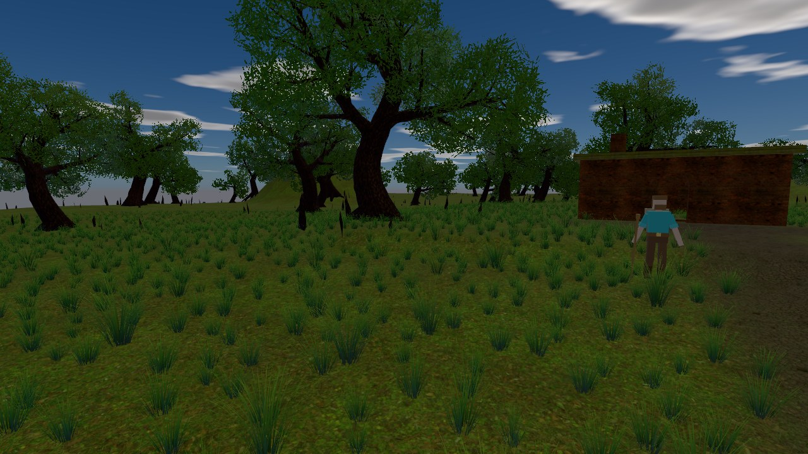
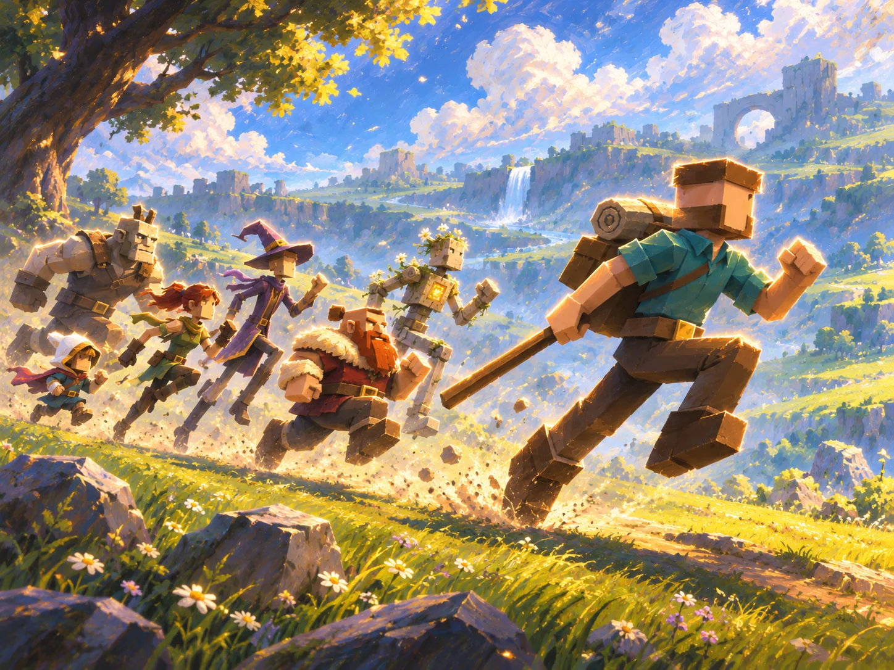

# Milestone 8C gate review: skeletal animation

**Date:** 2026-11-20 · **Reviewed by:** Sage (engineering)

**Goal (plan):** skinned meshes and animations from glTF (any rig Blender exports), an animation player, blending, a
simple state machine, root motion, an editor preview; retargeting through a humanoid bone map with presets for Rigify,
Mixamo, the Unreal mannequin and Blender's metarig; Alden Wayfarer as the test character; FBX researched.
([plan](M8_PLAN.md), [ADR-036](../decisions/ADR-036-skeletal-animation.md))
**Gate (spec):** each system has editor authoring, runtime behaviour, serialization, docs, performance notes and
tests. A feature that merely draws something for a frame is not finished.
**Verdict:** the gate passes. Every system meets every column below, and the exceptions are written down. The sample
found no engine bug: its two problems were the sample's own (a script that skipped its first leg, a test expecting 17
posed bones where the blend moves 9). It measured one cost worth naming: a crowd's CPU time grows with every bone
entity (about 35 µs a character a frame; 250 Aldens 9 ms), which stays an exception.

## Deliverables (the plan's parts)

| Part | What | Status | Evidence |
|---|---|---|---|
| 1 | Skinned meshes: skins from glTF, linear blend skinning in the vertex shader, shadows, the editor's viewport | ✅ | SimpleSkin's weights and inverse binds, hand-worked bends (unit tests); golden `Skinning`; 100 characters 0.2–0.4 ms of GPU (`render.skinning_cost`); the smoke test places a posed Ward with Vulkan validation on |
| 2 | Clips and the player: step, linear, cubic spline; the `animator`; scripts play, stop, speed, end events | ✅ | Sampled poses against hand-worked values; golden `Animation`; `cli.animation_scripts_build_identically` (Lua and C#, built game: the same end frames and bone fingerprints) |
| 3 | Blending and the controller: cross-fades, 1D and 2D blend spaces, masked and additive layers, `.nooranim` | ✅ | Blend maths by hand, transition timing exact to the frame; goldens `Blending_20/50/80`; `cli.animation_controller_build_identically`; 100 characters on the controller +1.0 ms of game update |
| 4 | Root motion and characters: into the character controller, events, props on bones, Create ▸ Player | ✅ | A walk covers its distance within a centimetre and stops at a wall; golden `Root_Motion` (a sword in his hand); `cli.root_motion_build_identically`; the smoke test walks the third-person player |
| 5 | Retargeting: the humanoid bone map, four presets and common names, corrections, rest-relative transfer, hips scaling | ✅ | Limb directions within 2° on T- and A-pose bodies of other proportions (unit tests); golden `Retargeting`; `cli.retargeting_build_identically` |
| 6 | The Animation panel: clips scrubbed, the skeleton shown, controllers edited, bone maps corrected | ✅ | API tests (the same moment, the same pose, the scene untouched; an edited fade followed exactly); the smoke test scrubs, edits a transition and maps a rig |
| 7 | FBX, research first | ✅ (go) | [FBX_RESEARCH.md](../animation/FBX_RESEARCH.md): 133 files, ours and others', read by NoorEngine and by Blender and compared; unit tests "fbx" |
| 8 | Sample and review | ✅ | This document; Alden on Hillside below |

## Gate criteria, system by system

| System | Editor authoring | Runtime | Serialization | Docs | Performance notes | Tests |
|---|---|---|---|---|---|---|
| Skinned meshes | placed from the Content Browser; bones are entities (Hierarchy, Inspector) | vertex-shader skinning, shadows, posed picking | glTF skins; the model's node list in the scene | ANIMATION.md, ADR-036 | 100 characters 0.2–0.4 ms of GPU | unit, golden, smoke test (validation on) |
| Clips and the player | `animator` in the Inspector; the Animation panel's Clips | `AnimatorSystem`, a pure function of time | the `animator` component | ANIMATION.md, LUA_API.md, CSHARP_API.md | 100 walking +0.43 ms of game update | unit, golden, built-game check |
| Blending, controllers | the Animation panel's Controller page (states, transitions, preview) | `AnimControllerPlayer`, stepped at the game's rate | `.nooranim` (versioned), the animator's parameters | ANIMATION.md, ADR-036 | 100 on a controller +1.0 ms | unit, goldens, built-game check, API and smoke tests |
| Root motion, events, sockets | `root_motion`, `events` in the Inspector; props parented to bones; Create ▸ Player | moves the character controller (walls, slopes) | the animator component | ANIMATION.md | within the controller's cost | unit, golden, built-game check, smoke test |
| Retargeting | the Animation panel's Bone map (preset, warnings, corrections) | baked once per pair at load; then ordinary clips | `.noormeta` `settings.bone_map`; `retarget_from` | ANIMATION.md, ADR-036 | once, at load (not measured: a few clips, milliseconds) | unit (directions within 2°), golden, built-game check, API and smoke tests |
| The Animation panel | itself | the preview poses the snapshot only | saves `.nooranim` and `.noormeta` | ANIMATION.md | a full republish per preview step (fine at sample scale) | API tests, smoke test |
| FBX | `.fbx` files are models in the Content Browser | `import_fbx`, every model load | `.noormeta` (importer "fbx") | FBX_RESEARCH.md, ANIMATION.md | 1.2 million triangles imported in about a second | unit "fbx", the research run (133 files) |

## The sample: Alden Wayfarer on Hillside (part 8)

`samples/Hillside/Scenes/Hillside_Alden.noorscene`, written by `tools/samples/add_hillside_alden.py` **through the
editor API**, as the editor would. Alden, NoorEngine's mascot, is made by `tools/samples/make_alden.py` from the
concept sheet's description (blocky; short brown hair and a beard; a teal tunic with rolled sleeves; a brown belt with
a gold buckle; dark trousers and boots; a backpack with a bedroll; his staff), on Ward's skeleton, so every motion
made for Ward is his. In fair weather he wanders a loop by the house on a character controller: walks, runs a
stretch, rests, walks on. His animator runs his controller (one state blending Idle, WalkForward and RunForward by
speed) with **root motion**: his walk and run move him, the slope lifts him; his script only steers and sets the pace.
His staff is a separate model on a socket: a child of his right hand's bone. It's a golden render five seconds in, and
the built Hillside game plays it exactly as the project does: every bone posed the same, Alden in the same place to
the millimetre, fifteen seconds in (`player.hillside_alden`).

## Performance notes

Measured by `tools/samples/measure_hillside_alden.py`: the whole Hillside frame (terrain, 142 oaks, 20,000 grass
clumps, the house, shadows) at 1280×720 on an RTX 3080; the fastest GPU frame of the best of three 400-frame runs; the
game update (scripts, physics, the animator) and gathering the scene for drawing on their medians.

| Hillside scene | GPU per frame | Game update | Gathering | Characters posed |
|---|---|---|---|---|
| Fair weather, no Alden | 1.27 ms | 0.17 ms | 0.40 ms | 0 |
| The sample (Alden) | 1.28 ms | 0.20 ms | 0.42 ms | 1 |
| **100 Aldens** (the crowd benchmark) | 1.28 ms | 1.93 ms | 1.96 ms | 100 |
| **250 Aldens** | 1.29 ms | 4.60 ms | 4.44 ms | 250 |

Each crowd Alden is a full copy: his own character controller, wandering script, controller and staff. **The GPU
doesn't notice them** (skinning a few hundred low-poly characters is within the noise). **The CPU does**: about 18 µs a
character of game update (part 3 measured the animator alone at about 10 µs; the rest is his character controller and
his Lua script) and about 17 µs of gathering, which walks every entity of the scene each frame, and each character is
twenty of them (his bones). 100 characters fit a 60 fps frame comfortably; 250 take 9 ms of CPU. Gathering is the
cheaper of the two to fix (cache the static part of the view, walk only what moved), noted below.

What 8C's features cost on their own test scenes: 100 skinned characters 0.2–0.4 ms of GPU and 1.2 ms of gathering
(part 1); 100 walking +0.43 ms of game update (part 2); 100 on a three-clip controller with a masked and an additive
layer +1.0 ms (part 3). Retargeting is a bake at load (once per pair of models). FBX imports at the speed of the file
(1.2 million triangles, 73 MB, in about a second).

## What the sample found

1. **The wandering script skipped its first leg** (the sample's own; fixed). Alden started on his first waypoint, so
   the script arrived at once and set off at a run. He starts at the last point now and walks the first leg.
2. **The built-game check expected 17 posed bones** (the test's own; fixed). Idle, the walk and the run move 9 of
   Ward's 17 (the hips, the chest, the legs and the upper arms); the others stay at rest, as they should.
3. **A crowd's CPU cost grows with its bone entities** (an exception, below): bones are entities (part 1's decision,
   which made sockets and scripts simple), and the scene is gathered entity by entity every frame.
4. **Hillside's own 8A walker** (a yellow capsule on its path script) wanders through the shot. It's part of the
   valley; left in.

Found earlier in 8C and fixed there, all with tests: bones posed at the frame's start while sprites showed its end;
one-shots' ends noticed a frame late; root motion ignoring an armature's scale (a Mixamo character would have walked
100 times too far); controllers' masks naming bones another body doesn't have; FBX bones resting where Blender left
them instead of where the skin was bound; FBX textures multiplied by a black colour value.

## Exceptions (accepted, tracked)

1. **Retargeting:** fingers aren't mapped; no foot IK (feet aren't fitted to the ground); root motion doesn't turn
   (yaw is the script's).
2. **Morph targets** (face shapes) are skipped, in glTF and FBX; levels of detail don't switch skinned models; the
   gizmo doesn't bend a skinned mesh while dragging.
3. **The Animation panel:** blend-space samples, layers and parameters are edited in the `.nooranim`; controller edits
   aren't on the undo stack; the graph's layout isn't saved; transitions can't interrupt a fade in progress.
4. **FBX:** Mixamo's and Unreal's own files weren't tried (none on hand; both use the FBX SDK the tried files came
   from); ASCII and pre-7 files untested; blend shapes, cameras and lights aren't imported; textures kept in another
   folder than the file names aren't found (the import lists them).
5. **Crowds cost CPU per bone entity:** about 35 µs a character a frame (update and gathering); 250 characters 9 ms.
   A cached view and gathering only what moved is the likely fix (ideas inbox).
6. **No quality settings** (as in 8A and 8B): a scene's choices decide the cost.
7. **One GPU tested** (NVIDIA RTX 3080, Windows 10), at 1280×720.

## Open questions

1. A "deep sea" environment without a water surface, before 8D's water? (From 8A.)
2. Which presets, if any, should use volumetric clouds? (From 8A.)
3. Eranu and Dunstan (The Uncounted) as further 8-direction test characters? (From 8B.)
4. May the docs name Tom's deep-sea project ("Thalassa"), whose store-bought creatures the FBX research used?

## Measurements
- Tests: **456/456** (RelWithDebInfo, incl. GPU, editor, samples and built games), up from 397 at the end of 8B.
- Golden-image scenes: 54 pictures, up from 46 when 8C started (8C added eight: skinning, animation, three blends,
  root motion, retargeting, Alden on Hillside).
- The crowd: see the table above.

## Alden discovers ...
**... that he can move.** Alden walking, then breaking into a run across Hillside, his staff swinging; behind him, a
row of very different figures copying his every step.

*Picture: Noor (2026-11-20), for the milestone tradition (Noor's idea, devlog #015).* And this time he really can:
the sample above is Alden himself, walking and running in NoorEngine.

## Next
**8D: water** (water bodies, reflections, shorelines that read the terrain, and underwater environments), as the plan
orders it. It starts with its own plan, as 8B and 8C did.
