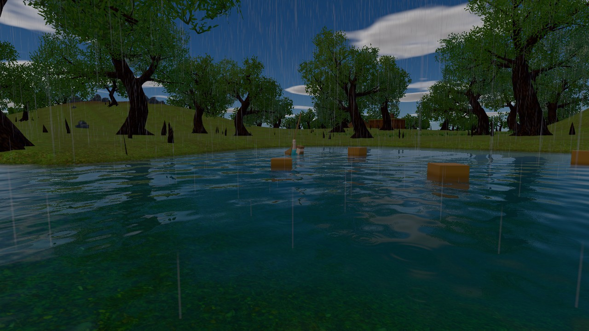

# Milestone 8D gate review: water

**Date:** 2026-11-20 · **Reviewed by:** Sage (engineering)

**Goal (plan):** water bodies (lakes, an endless sea, rivers), reflections, shorelines that read the terrain, waves
gameplay can trust, underwater environments (light absorbed with depth, fog, a surface seen from below), floating and
swimming, an editor panel with debug views. ([plan](M8_PLAN.md#8d-water), [ADR-037](../decisions/ADR-037-water.md),
[docs](../water/WATER.md))
**Gate (spec):** each system has editor authoring, runtime behaviour, serialization, docs, performance notes and
tests. A feature that merely draws something for a frame is not finished.
**Verdict:** the gate passes. Every system meets every column below, and the exceptions are written down. The sample
found one CPU cost worth naming (floating, about 20 µs a body a frame) and one number it couldn't yet explain (below).
Earlier in 8D one real engine bug was found by a test and fixed: Jolt's sleep froze floating bodies a few millimetres
off their depth.

## Deliverables (the plan's parts)

| Part | What | Status | Evidence |
|---|---|---|---|
| 1 | The water surface: the `water` component (box, sea), the scene copied once a frame, absorption by thickness, refraction, a soft shore, sky and sun reflections, `.noorwater` | ✅ | Hand-worked absorption (unit); goldens `Water_Pool`, `Water_Sea`, `Hillside_Lake`; the copy 0.02 ms |
| 2 | Waves: Gerstner waves from the look and the wind, the sea's grid to the horizon, `water_height` for Lua and C# | ✅ | The drawn surface read back from the depth buffer within 6.2 mm of `water_height` (`render.water_readback`); buoys identical in a built game; goldens at two moments |
| 3 | Shorelines and reflections: depth maps from the terrains, waves calmed in the shallows, foam, wet sand, screen-space reflections | ✅ | Damping and depth maps by hand (unit); over a beach within 7.4 mm (`render.water_readback_shore`); goldens `Water_Shore`, `Water_Reflection` (the house in the pond) |
| 4 | Underwater: light dimmed by depth with caustics, the water's fog with shafts, Snell's window and total internal reflection, the waterline, exposure, the Deep sea preset | ✅ | A camera walked through the surface: the biggest step 16% of the whole change (`render.water_descent`); goldens `Water_Underwater`, `Water_DeepSea`, `Water_Waterline` |
| 5 | Water in the game: floating, wading and swimming with `on_water`, splashes, rain and wind on the surface | ✅ | Planks of three densities within a micrometre of their depth, a character's wading speed and swimming height, exact splash counts (unit); the rainy sea identical in a built game (`player.water_float`) |
| 6 | Rivers: a spline body, flowing, joining a lake; the flow for scripts and floating | ✅ | A crate carried at the river's 1.5 m/s within 2% (unit); goldens `Water_River`, `Water_River_Mouth` |
| 7 | The Water panel and debug views | ✅ | API tests (presets, apply in one undo step, edits reaching what a game reads); the smoke test edits a lake and sees the viewport change |
| 8 | Sample and review | ✅ | This document; the lake, its stream and Alden swimming below |

## Gate criteria, system by system

| System | Editor authoring | Runtime | Serialization | Docs | Performance notes | Tests |
|---|---|---|---|---|---|---|
| Water bodies (box, sea) and looks | Create ▸ Water; the Inspector; the Water panel (gallery, live edit) | `water` drawn in the see-through pass over the copied scene | the `water` component; `.noorwater` (versioned) | WATER.md, ADR-037 | a lake 0.04 ms, the copy 0.02 ms | unit, goldens, API, smoke |
| Waves | look fields (height, length, direction, choppiness, wind) | Gerstner on the GPU and the CPU, one formula | the look | WATER.md, LUA_API.md, CSHARP_API.md | the wavy sea 0.1 ms (part 2) | unit, readback, built game, goldens |
| Shorelines and reflections | look fields (foam, wet, reflections) | depth maps from terrains; foam, wet band, SSR | the look; depth maps are derived (not saved) | WATER.md | reflections 0.14 ms on a wavy sea | unit, readback over a beach, goldens |
| Underwater | look fields (caustics, shafts); the environment's `underwater_*` | light under water in every mesh; two passes from inside | the look; the environment | WATER.md | from inside about +0.3 ms | unit, the descent check, goldens |
| Floating, wading, swimming, splashes | `rigidbody` (`buoyancy`, `water_drag`), `character` (`swim_depth`...), emitters' `collide.water` | Jolt forces from the water query; the character controller; particles | components | WATER.md, `physics.h`, script references | floating ~20 µs a body (below) | unit, built game, golden |
| Rivers | the `water` component's points (no spline tool) | a ribbon from the course; `flow` for gameplay | the component | WATER.md | within the water pass | unit, goldens |
| The Water panel, debug views | itself | the debug view in the viewports and the player | writes `.noorwater` | WATER.md | a republish per edit | API tests, smoke test |

## The sample: water on Hillside (part 8)

`samples/Hillside/Scenes/Hillside_Water.noorscene`, written by `tools/samples/add_hillside_water.py` **through the
editor API**, as the editor would: the Hillside lake in light rain, rain rings on the water. In this scene's own sculpt
layer a channel is carved down the gentle slope south-west of the lake (the script checks its bed is under the water
and its banks above it), and a river runs along it into the lake. Four crates of different densities float on the
lake. Alden Wayfarer walks a loop that wades into the lake and swims across its deep middle: his character controller
slows him as the water deepens, `on_water` from it switches his controller to **his new swim stroke** (a front crawl
generated by `make_alden.py`, as ADR-037 promised), and he walks out the other side. He still holds his staff while he
swims; it sticks up out of the water like a periscope. It's a golden render ten seconds in, and the built Hillside
game plays it exactly as the project does: Alden swimming in the same place to the bit, every bone posed the same,
every crate in the same place (`player.hillside_water`).

The deep sea and the seaside are test scenes rather than samples: `Water_DeepSea` (18 m down: shafts, rocks and a long
dark shape in the gloom, the mood Thalassa wants), `Water_Shore` (a sandy coast with foam and wet sand) and
`Water_Float` (the sea in the rain with floating bodies and splashes), all goldens.

## Performance notes

Measured by `tools/samples/measure_hillside_water.py`: the whole Hillside frame at 1280×720 on an RTX 3080; the fastest
GPU frame of the best of three 400-frame runs, the Scene and See-through passes of that frame, and the game update on
its median.

| Hillside scene | GPU per frame | Scene pass | See-through (water) | Game update |
|---|---|---|---|---|
| The sample (lake, stream, rain, 4 crates, Alden swimming) | 1.54 ms | 0.62 ms | 0.267 ms | 0.40 ms |
| Without the stream | 1.54 ms | 0.62 ms | 0.264 ms | 0.35 ms |
| Without the rain | 1.59 ms | 0.67 ms | 0.223 ms | 0.42 ms |
| **100 floating crates** | 1.98 ms | 1.02 ms | 0.247 ms | 2.32 ms |
| The same valley with no water at all | 1.67 ms | 0.95 ms | 0.046 ms | 0.24 ms |

**The water itself** (the see-through pass: the lake, the stream, the rain's rings) costs about 0.22 ms over the dry
valley; the stream adds almost nothing on its own. **Floating costs CPU**: a hundred crates add about 1.9 ms of game
update, about 20 µs a crate a frame (each is 27 cells, each asking the water's height every step), on top of a hundred
more bodies to draw. A handful of floating things is cheap; a harbour full is not yet. **Not yet explained**: the dry
valley's opaque pass is slower (0.95 ms) than the sample's (0.62 ms). Without water, the camera sees the lake's dry
hollow and its grass, and Alden walks rather than swims; I haven't measured which of those it is, so it stays an open
question, not an excuse.

What 8D's features cost on their own test scenes (1280×720): the scene copy 0.02 ms; a calm lake 0.04 ms; the wavy sea
0.32 ms (0.14 of it reflections, 0.03 foam); from inside the water about +0.3 ms (the fog's march); the descent and the
debug views nothing measurable beyond that.

## What the sample found

1. **Floating's CPU cost** (an exception, below): measured for the first time here, about 20 µs a body.
2. **Alden's built-game check expected 9 posed bones** (the test's own; fixed): his controller's new swim state moves
   his neck and head too, so it's 11 now. His walk on the same scene is unchanged (its golden matched).
3. **His staff stays in his hand while he swims.** Left in: it's funny, and a socket that let go in water would be a
   game's choice, not the engine's.
4. **The dry valley's slower opaque pass** (above): an open question.

Found earlier in 8D and fixed there, all with tests: GPU Gems' short wave normal 2 cm a metre off on choppy crests (part
2); foam painted as a ring, then lacy (part 3); the deep sea pitch black (too much absorption, exposure not adapting:
part 4); floating bodies frozen off their depth by Jolt's sleep, then looping for ever (part 5); rapids foam on the
whole river (part 6); a look's file read from disk every frame (part 7).

## Exceptions (accepted, tracked)

1. **Floating costs about 20 µs a body a frame.** Fewer cells for small or far bodies, or asking the water once per body
   and working the cells out from that, are the likely fixes (ideas inbox).
2. **Waves** don't slow, turn or break in the shallows (they only calm); four waves repeat if you look for it across a
   big sea; far out the drawn waves are calmer than gameplay's.
3. **Reflections** are screen-space: off-screen things show as sky; no planar reflections (ADR-037).
4. **Underwater**: one body at a time from inside; glass, smoke and particles aren't fogged; depth counts from the
   level, not the waves overhead; caustics and shafts are patterns, not traced light; no bubbles, drops on the lens or
   splashes by themselves.
5. **Rivers**: one speed across; not seen from underneath and no light dimmed under them; no waterfalls; no wet bank;
   no spline tool (points are numbers in the Inspector).
6. **The Water panel**: text fields (no sliders or colour pickers); every gallery picture is the same coast.
7. **Depth maps come only from terrains**: a beach made of a mesh gets foam and wet sand, not calmer waves.
8. **No quality settings** (as in 8A–8C) and **one GPU tested** (NVIDIA RTX 3080, Windows 10), at 1280×720.

## Open questions

1. The dry valley's slower opaque pass (above): what is it?
2. Thalassa (Tom's deep-sea game): which of its scenes, creatures or moods should the engine try first? (Its
   store-bought packs stay out of the repository.)
3. World generation in the spirit of Thornwake's (ideas inbox): lakes at their spill level and rivers from its
   hydrology would feed 8D's water directly. When?

## Measurements
- Tests: **501** (RelWithDebInfo, incl. GPU, editor, samples and built games), up from 456 at the end of 8C. In the
  last full run 500 passed and the editor smoke test failed once: its play-mode check timed a building turning
  against the wall clock while heavy GPU tests ran beside it. Made robust (it waits for the turn and checks the most
  it may turn in the time taken) and passing alone.
- Golden-image scenes: **68** pictures, up from 54 when 8D started (8D added fourteen: the pool, the sea, the Hillside
  lake, waves at two moments, the shore, the reflecting pond, under the pond, the deep sea, the waterline, the rainy
  sea, the river and its mouth, and water on Hillside).
- The sample: see the table above.

## Alden discovers ...
**... that he can swim.** Alden halfway across a lake in the rain, doing a determined front crawl with his staff held
up out of the water like a periscope, crates bobbing round him; below him the water goes green, then dark, and
something long and patient is down there, watching.

*Picture: to come from Noor (the tradition: Sage writes the line, Noor paints it).*

## Next
**Milestone 8 is complete**: its four groups (8A sky and environments, 8B particles and sprites, 8C skeletal animation,
8D water) each passed their own gate. "Later (8 or 9)" (volumetric fog, streaming for big worlds) stays unscheduled.
The spec's **Milestone 9** is deep procedural world building: roads, architecture, cities, vegetation ecology and
simulation. It starts with a proposal, as Milestone 8 did; Thornwake's world generation (ideas inbox) is a natural
input to it, and its rivers and lakes would land straight on 8D's water.
